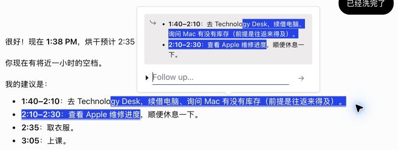
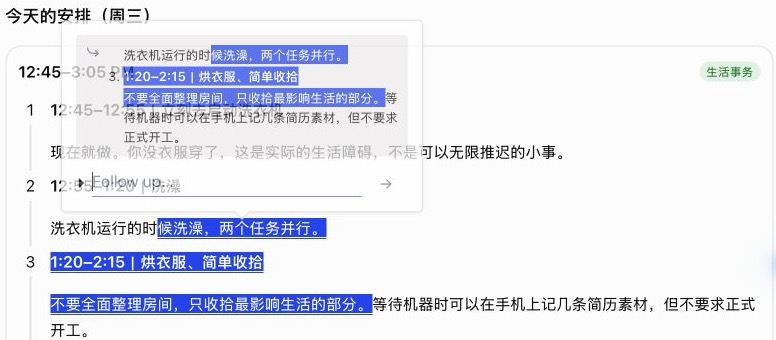
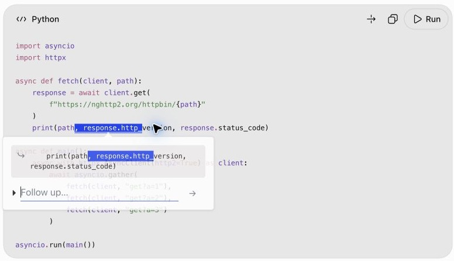
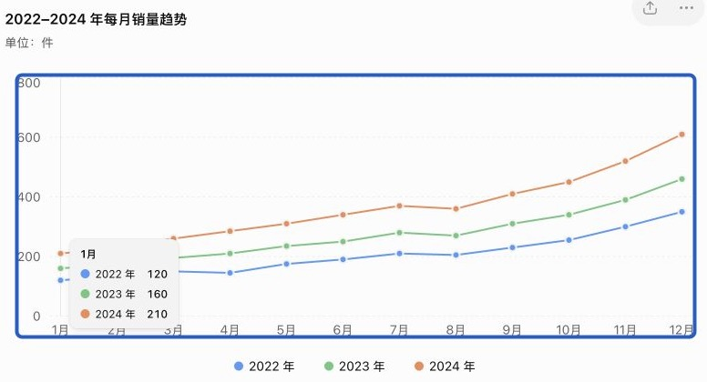
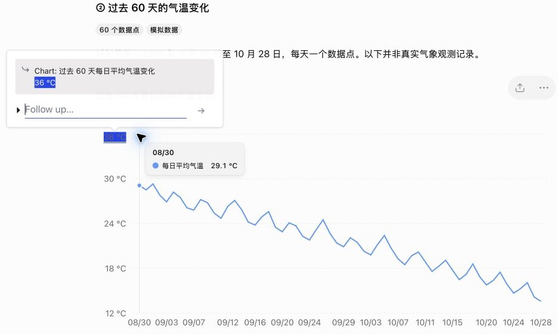
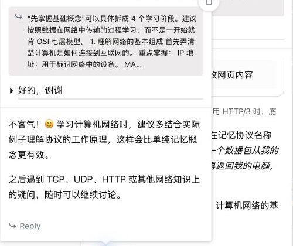
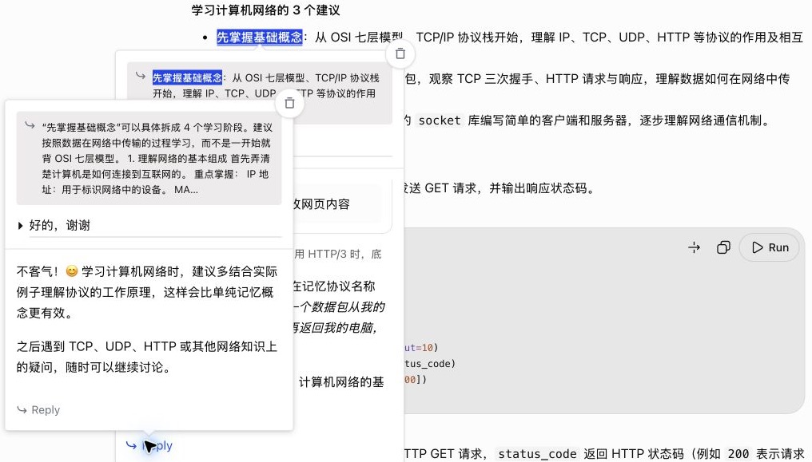

# TODO — 2026 H2: Maintenance & Updates

The development-phase steps (2026 H1, Steps 1–9) are in [TODO.md](TODO.md) and closed.
Work through these steps **in order**. Do not skip ahead or add features from later steps.
Detailed plans: `collab/PLAN-next.md` (Chinese).

## Step 1: Special Response Formats (ChatGPT) — CURRENT
- Plan and test matrix: `collab/PLAN-next.md`, section "特殊回答格式审查"
- Known bugs:
  - R1 a quote spanning list items repeats a bullet — fixed 1.2.10-dev.1, verified T1
  - R2 the same for ChatGPT's new step cards (numbered cards with a tag chip) — fixed dev.1, verified T1
  - R3 code blocks get no page highlight; their quote includes toolbar text ("PythonRun") and loses line breaks — fixed dev.2 (quote) + dev.3 (highlight), verified T1
  - R4 highlighting chart axis labels breaks the SVG chart and throws the popup to the bottom of the page — fixed dev.3, verified T1 (legend and tooltip text cannot be selected at all)
  - R5 the Reply quote (and the message sent) ends with the word "Reply" — fixed dev.1, verified T1
  - R6 clicking Reply while its reply popup is open stacks another copy of it — fixed dev.1, verified T1
  - R8 (reported 2026-10-28, not started) Popup is active on every chatgpt.com page (settings, GPTs, library, …), not only in chats. Note: ChatGPT is a single-page app, so the content scripts must still load on all pages (no reload when moving between pages); Popup has to switch itself on and off by route.
  - R9 (found in live test T1, fix in 1.2.10-dev.4, not yet verified) after a reload, a highlight in an answer that fills in late is not restored
- Evidence (live test T1 by the operator, 1.2.10-dev.3, ChatGPT 2026-10-28). Cropped screenshots, one per bug you reported:

  **R1 列表引用重复** — 当时：选区跨两个 bullet，引用里同一个 bullet 出现两次。现在：每条一次，时间粗体保留。

  

  **R2 步骤卡片重复** — 当时：选区跨两步，引用里第 3 步重复。现在：每项一次，新的一项前面有序号「3.」。

  

  **R3 代码** — 当时：页面上的代码没有高亮；引用是「PythonRunimport asyncio…」整块连成一段。现在：页面上蓝底白字高亮，代码块没变；引用只有碰到的那一行，等宽、缩进保留。

  

  **R4 图表** — 当时：选中坐标轴数字后图表坏掉（数字被截断或消失），popup 飞到页面底部。修复前（1.2.10-dev.2，纵轴 800/600/400 的首位被截掉）：

  

  现在：图表完好，选中的「36 °C」有高亮，popup 在旁边，引用是「Chart: 标题」加选中的文字：

  

  **R5 Reply 引用带「Reply」** — 当时：reply popup 的引用末尾是「…还是只是来打个招呼？ Reply」。现在：引用以回答本身结束（「…MA…」），没有「Reply」。

  

  **R6 Reply 重复叠 popup** — 当时：再点 Reply 会叠出 4 层一样的 reply popup。现在：点了两次 Reply，仍然只有原 popup 和一个 reply popup（2 层）。

  

- 1a Inventory ChatGPT's high-risk answer components (lists, step cards, tables, code, math, charts/widgets, citations, collapsibles)
- 1b Offline fixtures in `tools/dom-test.html` for each component; checks C1–C9; they fail on R1–R4 before any fix
- 1c Fixes (design confirmed with the user first), then live verification and full regression

## Step 2: Images in Popups (ChatGPT) — plan approved, step 0 done
- Paste or drag images into a popup's input; ChatGPT uploads them through its own flow (synthetic `paste` on the composer works; file input and `drop` don't)
- 2a Popup inputs accept images, thumbnail strip
- 2b Send: attach to the composer, wait for the upload, fix send timers, `questionFromBody` in `src/net-tap.js`
- 2c Show images in popups; storage keeps only an `images` count; read back after reload
- Evaluation probes (`src/dev-imgtest.js`) never go into the store zip

## Step 3: DeepSeek Support — feasibility done; claude.ai on hold
- 3a Refactor without changing ChatGPT behavior: pick the site by URL, one conversation-id rule, per-site storage key prefix
- 3b DeepSeek adapter (`src/sites/deepseek.js`) and network listener (`src/sites/deepseek-net.js`)
- 3c Read back answers not on screen (`history_messages`)
- 3d Live tests (4 approved messages left), light/dark, full ChatGPT regression
- claude.ai: decide after DeepSeek (CSS hiding flashes blank space while scrolling)
