# TODO — 2026 H2: Maintenance & Updates

The development-phase steps (2026 H1, Steps 1–9) are in [TODO.md](TODO.md) and closed.
Work through these steps **in order**. Do not skip ahead or add features from later steps.
Detailed plans: `collab/PLAN-next.md` (Chinese). Status and how to continue: `collab/HANDOFF.md`; how we work: `collab/PROTOCOL.md`.

**2026-10-29:** 1.2.11 built (`dist/Popup-1.2.11.zip`) with Steps 1 and 2 — the user uploads it to the Chrome Web Store.

**2026-10-30:** new Step 3 (popup height, direction, answer-format gaps; grilling done with the user) inserted before DeepSeek, which is now Step 4. Next: Step 3.

## Current status — as of 2026-11-20 06:35 (read this first; the sections further down are history)
Released to the store: 1.2.14 (commit 1e8649b). **1.2.15 zipped again 2026-11-20 11:55 after the audit (commit 672d1b1, sha256 2b85a7d5…), for the user to upload** (the 06:35 zip is replaced) (goal: releasable 2026-11-20 — user, 01:45: 12 hours overnight; all three sites with no known bug).
Update 02:45 (user): **D is in scope tonight too** (4e draft, P0-7, architecture #3/#5–#8); B4 must be fixed (without breaking old answers); both Chromes usable tonight only — from the morning no Chrome Beta and no more time: everything done by then.
User approvals for tonight (01:50): Codex may use the user's **Chrome Beta** (it has ChatGPT's new front end) while the user sleeps; the DeepSeek data filter may rewrite DeepSeek's parent message id (like ChatGPT); commit and push to `main` after each item. The store upload stays with the user. Testing ≤ 40 % of the time: one offline test per fix (fails before / passes after), then few, wide Codex rounds with in-page recorders that show who is responsible.

### Progress overnight (03:25) — dev.1 … dev.14, all pushed to main, offline ALL PASS
- Live PASS (Codex, rounds 1–3): B1 old ChatGPT (O1/O1b/O2), new ChatGPT N1/N1c (popups follow the anchor, dev.10/12), N0 old answers via the frame (0.4–1.2 s once the frame has loaded the paginated history; the first open right after a reload can take ~10 s), B2 claude.ai C2 + Claude Code C1 (question row frozen, never seen), A4 direction (N2/O2, C1), A5 (N3/D2 fully visible; a short popup's bottom edge isn't draggable by design), B4 DeepSeek D1 (20 steps up: total height constant, no pull back) + D4 (old answers still DeepSeek's drawing) + D5, B3 (110 popups rebuilt from the conversation on Chrome Beta = "new computer").
- Fixed after live findings: N1b/N1d popups off their highlight while ChatGPT's new front end collapsed its list (glue, places taken at the hold's start); C1 a popup that makes the page longer still ends under the composer (fits = what the chat can scroll to, measured without the popup; below needs ≥ min(popup, 40vh)); a site scroll must keep the anchor within 40 px.
- D done: 4e draft text + files (set aside, handed back); P0-7 #3 (JR.site.original), #4 (one click-forwarding rule), #5 (site-answer interface trimmed); architecture #6 (popupMessageDeleted shared), #8 (DeepSeek code blocks follow a theme switch), #9 (= P0-7 #3), #10 cleanups, conversation-id rule from JR_HOST. Not done, on purpose: 4e "the draft stays visible during the send" (a still copy over the box would look off — the draft is back right after); architecture #3 (the hide CSS is the one truth of what is hidden, incl. DeepSeek's question id = answer − 1; a key list would copy that rule into the page world) and #5 (the answer-stream contract touches "is the answer done", the most delicate path — after the release).
- Known cost (B3): every chat load reads the conversation once (ChatGPT /backend-api/conversation, DeepSeek history, claude.ai chat) to find Popup questions with no item — no extra for chats that have Popup items (it was read for their answers anyway); one extra request for a chat never used with Popup. Not gated on net-tap's filter count: ChatGPT's new front end pages its history, the first page saying "none" doesn't mean none.
- Running: round 4 — N1c PASS, N1d FAIL → fixed dev.12 (verify); compact regression B2/B4/B5/B6/B7/B9/B11/B13/B17/B18 on old ChatGPT, DeepSeek, claude.ai, Claude Code, new ChatGPT (loaded build: dev.10 — dev.11–14 need the final smoke).

### 1.2.15 audit (11:00–11:55) — re-zipped: `dist/popup-1.2.15.zip` (26 files, sha256 2b85a7d5…, = commit 672d1b1); the store upload is the user's
- The overnight work had no ponytail review before "done" (user, 11:00: "有审计过吗"). Two fresh reviews (dev.1–15, dev.16–33) + a peer session's audit. Fixed: 34bfcc4 (4e: the user's files leave the box at the real send, not the click — a queued send carried a file added meanwhile, hidden; stuck send keeps the draft; rebuild: sentence first, never-placeable turns stored hidden — a flash on DeepSeek/claude.ai each load; no double rebuild from two tabs; sweep stops on another jump; .orig leftovers removed; tools/storage-test.js), 23eb240 (dead extension context: the rebuild restored again forever — the tab hung; the send waits for the set-aside cards to go), 535defe (ChatGPT's new front end names a pasted image.png "image(20261120-164031).png": 4e refused the send — in the 06:35 zip), 672d1b1 (Esc while ∧ ∨ still searches stops it).
- Live retest (old Chrome only): R1 ChatGPT 4e PASS (535defe), R2 DeepSeek 4e PASS, R3 claude.ai 4e PASS, R4 reload counts same on all three PASS, R5a Claude Code ∧ at the bottom PASS once (a second try ended by itself while the session's agents streamed: the site pulled the chat back down — not this change; diagnostics "reached=false"), R5b Esc stops the search PASS.
- Left: the below-popup height cap set once at open (nice to have); markUser ignores keyboard/scrollbar in a popup during a send (unverified); window.JRDeepSeekNet test hooks in the page (after release); Claude Code ∧ ∨ search while an agent streams can be pulled back to the bottom.

### 1.2.15 zipped (06:35) — dev.33 = "1.2.15" (replaced by the 11:55 zip)
- Round 5 (live, both Chromes, all three sites + Claude Code) all PASS on dev.21–33 — docs/REGRESSION-LOG.md first row. Fixed in round 5: dev.21 (DeepSeek: a send's turn hidden before it is drawn), dev.22/23 (ChatGPT new front end: the popup left its highlight while the list moved / was held 50 px low), dev.24/25/32 (old answers via the frame: 100-turn pages, the first page too, a real scroll at the top), dev.25 (429 retried), dev.26 (4e: the box keeps its height), dev.27–31 (Claude Code: the arrows' place and order, reaching rows not mounted, shadow-DOM code blocks + Copy), dev.33 (a popup the user moves during a send keeps its place).
- Known, not fixed: right after a reload the first old answer on ChatGPT's new front end can take longer (the frame boots ChatGPT, ~5 s, then loads the history); C4 not observable (upload too fast); performance #5 (DeepSeek keeps up to ~260 items drawn at the bottom, 76 with a popup open) and #10–#14; architecture #3/#5 (after the release, as planned).

### Progress overnight (04:40) — dev.15 … dev.20
- Round 4 results: DeepSeek all PASS; claude.ai B9 FAIL (a reopened table squeezed to a character per line) → dev.16, B17 FAIL (∨ at the top went to 5 of 10) → dev.16; Claude Code B17 (no ∧ ∨ at all: its right panel was taken for an opened sidebar) → dev.17, B9 "code box not visible" (to recheck); Chrome Beta ChatGPT B2/B4/B5/B6 FAIL (after a send the page jumped to a later passage) — to investigate in round 5 with the recorders; B17 old answers still "Loading" (the frame: same cause as "Couldn't load earlier messages") → dev.18 (100 turns per extra history request; measured 172 messages in 0.6 s).
- **Performance (user, 04:30, via another session's read-only audit: "make it part of tonight's TODO, do it now, then the rest")** — audit: `~/Library/Application Support/Claude/scratch-workspaces/…/popup-perf-audit.md` (14 items). Done:
  - dev.19 (must fix): DeepSeek's whole-list measuring pass (~0.7 s) only when a newly hidden item isn't on the page (was on every send); a rebuild of ~100 items is one write (was ~100 whole-document writes), the quoted answers' plain text made once per turn; a tab keeps its cache on its own writes, the arrows / DeepSeek's outline re-read only on writes of this conversation.
  - dev.20 (should fix): the freeze observer skips changes only inside hidden turns (the hidden answer streaming); a send's new turn hidden and linked in one write; at most 10 user files held, cleared when the box has none; the mount pass looks each turn up once.
  - Not done, on purpose: #5 (fewer DeepSeek items kept drawn for a popup — the copy follows its original while the answer is live); #10–#14 (small: a few ms each).
  - Owed: before/after numbers in the same chat (JR.diagnose perf: before = storageWriteMs n=16 / 2076 ms, longTaskMs n=44 / 4832 ms on Chrome Beta ChatGPT; DeepSeek a send's long task) — in round 5.

### A. Fixed in code tonight — offline ALL PASS, not yet checked live
- A1 DeepSeek pull back to the bottom (part 1): its follow check read Popup's taller list height → `scrollHeight` grows by the same amount (deepseek-net.js). Not the whole cause: see B4.
- A2 An answer longer than 2 min: the scroll lock lapsed while Popup still held the view → renewed every 30 s while the answer runs (chat.js holdView). Live: an 11 s answer fine; > 2 min only offline.
- A3 A key pressed right after a click on a site button in a popup lost its modifiers (Cmd+C → "c") → forwarded with them (site-render.js).
- A4 Popup side (user's rule, ChatGPT and again 2026-11-20): first the side where it can be seen whole (the chat can scroll far enough, not behind the composer), only then high/low on screen (popup-helpers.js `bestDirection`, `growsBelow`).
- A5 A popup below near the end of a chat that clips it (ChatGPT, DeepSeek, Claude Code; DeepSeek's first sentence) was cut off, its bottom edge out of reach → no taller than the chat can scroll to (`capBelow`, `--jr-popup-cap`).

### B. Open bugs — tonight, in this order
- B1 **ChatGPT new front end** (Chrome Beta: `76629.15f5868e7b`; old Chrome `37bbb723cd`): a Popup send mid-chat jumps to another passage, all highlights gone, the popup hangs on the wrong highlight or closes ("collapses", the user must click again). Recorded 01:30: Popup's scroll guard blocked 5 of ChatGPT's own `scrollTo` (1387 → 3903, its keeping of the reading position); lockScroll then fell back to the old scrollTop 1414 because the anchor turn was unmounted — another passage now. Fix: during a send block only site scrolls that take the reader's anchor out of view; never fall back to a stale scrollTop. Includes **P0-1** (old build: ~50 ms placeholders at the top when sending from inside a very long answer).
- B2 **Claude Code**: the Popup message shows in the main chat for a moment before it is hidden — it must never be seen. (claude.ai chat: check the same.)
- B3 **History from the conversation itself**: on a new computer / after storage loss the Q&As are hidden (by message format) but every highlight is gone; DeepSeek's outline shows every Popup question as "· deleted". Fix: one normalized site-conversation read for all three sites (architecture report #1: `qa-content.js` branches per site today), then "adopt or create" highlights from the quote each Popup message carries (#2); local storage keeps only what the conversation lacks (deletions, popup sizes). With it the quick duplicate cleanups (#4/#6: message prefixes copied 3×, `textWithBreaks` 3× with different paragraph rules, host/scroller rules 3×). Report: `$TMPDIR/architecture-review-20261120-0126.html`.
- B4 **DeepSeek pull back to the bottom / flicker while scrolling up — fixed (dev.8)**: the Popup Q&As are items of DeepSeek's virtual list (0 px), each first counted ~60 px, then measured 0, so the chat shrank under the reader (10152 → 5916 px). Fix: one whole-list measuring pass (DeepSeek draws every item once and keeps their real heights), the window again 120 ms later; old answers stay DeepSeek's own drawing. Live round 4: D1 (20 steps up, total height constant, no pull back), D4, D5 PASS. dev.19/21 (performance): the pass only when a newly hidden item isn't on the page and isn't a send's turn kept drawn (was on every send, ~0.7 s) — round 5 rechecks D1 and a reload's self-heal on dev.21. (Plan A, filtering them out of DeepSeek's data, was dropped: it breaks old answers.)
- B5 Small: while dragging a popup edge the cursor turns back into an arrow once the pointer leaves the popup → resize cursor on the page while dragging.

### C. Checks owed
- C1 Live checks of A1–A5 and B1–B5 (each fix: its own case, on the sites it touches).
- C2 One wide regression round: docs/REGRESSION.md Part B/C/D on ChatGPT (old and new front end), DeepSeek, claude.ai chat, Claude Code — light/dark, another UI language; recorders on; re-run only the failures. (Started 2026-11-20 00:20 on DeepSeek: B1–B6 PASS, B7 half; B6's "wrong arrow" was a misread.)
- C3 Rebuild test data where it was lost (ChatGPT, DeepSeek): popups with versions, nested, a Reply chain, an image, a code block — the regression's own steps do most of it.
- C4 claude.ai: the upload-in-progress marker with a big file (never checked).
- C5 Then 1.2.15: manifest version, `tools/build-zip.sh`, HANDOFF, commit, push.

### D. Not in this release / later
- 4e keep the main box's draft during a Popup send (text part in `collab/patches/4e-draft-text.patch`; files and the look not started) — not in this release (user, 2026-11-19); ask before doing.
- P0-7 structure candidates 3–5 (originals behind one seam, click forwarding as one rule, trim site-answer's interface) — after the release.
- Architecture report #3 (one page-world channel for "which keys are hidden / which one to draw"), #5 (minimal answer-stream contract; claude.ai has none), #6–#8 (outline status logic out of deepseek.js, `JR.site.original`, theme marker) — after the release.

### E. Checked tonight, not Popup bugs (no code)
- DeepSeek's outline flashing on hover and a resize cursor that won't stay: Codex's Computer Use re-posts the user's mouse moves off-window while attached to that Chrome (trusted `mouseout` at x − 1920, y − 54). Rule now: the user uses Chrome Beta, Codex the old Chrome (except tonight, see approvals).
- ChatGPT's at-the-bottom check is not fooled by Popup's taller viewport (it reads the element, not the observer entry); claude.ai's synthetic wheel only cancels its follow animation / a running jump landing.

## Step 1: Special Response Formats (ChatGPT) — DONE (R1–R14), released in 1.2.11
- Plan and test matrix: `collab/PLAN-next.md`, section "特殊回答格式审查"
- Known bugs:
  - R1 a quote spanning list items repeats a bullet — fixed 1.2.10-dev.1, verified T1
  - R2 the same for ChatGPT's new step cards (numbered cards with a tag chip) — fixed dev.1, verified T1
  - R3 code blocks get no page highlight; their quote includes toolbar text ("PythonRun") and loses line breaks — fixed dev.2 (quote) + dev.3 (highlight), verified T1
  - R4 highlighting chart axis labels breaks the SVG chart and throws the popup to the bottom of the page — fixed dev.3, white label text dev.5, verified T1/T3 (legend and tooltip text cannot be selected at all)
  - R5 the Reply quote (and the message sent) ends with the word "Reply" — fixed dev.1, verified T1
  - R6 clicking Reply while its reply popup is open stacks another copy of it — fixed dev.1, verified T1
  - Review (ponytail, 2026-10-28) of dev.1-dev.5 → fixed in dev.6: removing a chart/code highlight no longer runs normalize() inside the CodeMirror editor; ChatGPT selectors only in the site adapter. Live test T4 (dev.6): R1-R6 regression passed; code block intact after Esc and after deleting a sent highlight; copy button works after Popup was used (one copy right after a delete did not update the clipboard once and could not be reproduced; the code block's DOM was byte-identical, so it is put down to the test tool)
  - R7 (checked, closed) "This response couldn't load" after a reload: also with Popup switched off, so it is ChatGPT's own (DEBUG #56); not fixed
  - R10 a selection across a map widget highlighted (and garbled) the map's own marker labels and ratings, and drew a line across the map — fixed 1.2.10-dev.8/dev.9 (highlights skip text the browser does not select or show: user-select: none, visibility: hidden, opacity 0 on its own element), verified T5 (map clean, highlights still restore)
  - R12 (found while collecting evidence) a selection inside one item of a current list (li > div > div > p) lost its bullet in the quote: the single-item path still used the old first-child rule — fixed 1.2.10-dev.10
  - R13 (reported 2026-10-29) a popup answer in ChatGPT's rich format shows its raw component markup (`<box border radius="lg" padding={3}>`, `<icon name="arrow-down"/>`) as text: Popup's own markdown renderer (answers read back from the conversation data or the stream, e.g. after every reload, since Popup Q&As are filtered out of the page and ChatGPT never renders them) does not know the component tags — fixed 1.2.11-dev.13: Popup draws them (boxes, card grids, title rows, badges, captions, dividers, icons as symbols; lines inside a component stay separate). Known limit: Mermaid diagrams show as code
  - R14 (found while testing answer formats in popups, T15, 2026-10-29) more components showed as raw text after a reload — `<CodeBlock>`, `<Chart content={{…}}/>`, `<Cite/>`, `<MapWidgetV2/>`, `<AsyncImage/>`, `<Entity/>`, `<Link/>` and scripted checklists (`{@body}`, `{#each}`, `<checkbox>`); fresh answers with a chart or map showed a blank widget (ChatGPT draws them only on screen; the Popup turn is hidden); ChatGPT's own tables overflowed a popup; task lists showed `[ ]`; ChatGPT's page CSS hid checkboxes and squeezed wide tables — fixed 1.2.11-dev.14–dev.16, verified T16–T17; review fixes dev.17 (inline code never read as template or CodeBlock, self-closing components close, no blank-chart copy while streaming), verified T18. Decided with the user: Popup draws answers itself (no reuse of ChatGPT's HTML after a reload); charts as a simple line/bar chart (other kinds as a table); maps as a place list with map links; source markers hidden; templates read as JSON data, never run. Known limit: formulas after a reload show as TeX
  - R11 (checked, closed) opening the file preview after selecting the CSV download link: ChatGPT treats a drag that starts inside a link as a click; not Popup
  - R8 — fixed 1.2.10-dev.7, verified F3 (off on new-chat, temporary chat, GPTs, library, Codex, project home, settings; on in chats; entering a chat from the home page restores highlights; leaving a chat removes popups and the nav widget; project chats untested: no project chat exists yet). Decided with the user: Popup works only on pages whose path has /c/<id> — normal, GPT and project chats; off on every other page and in temporary chats; "off" = no trigger button, nav widget, storage reads or page observers, while the network filter keeps running so hidden Q&As stay hidden the moment a chat opens) Popup is active on every chatgpt.com page (settings, GPTs, library, …), not only in chats. Note: ChatGPT is a single-page app, so the content scripts must still load on all pages (no reload when moving between pages); Popup has to switch itself on and off by route.
  - R9 (found in live test T1, fix in 1.2.10-dev.4) after a reload, a highlight in an answer that fills in late is not restored — verified when entering the chat from the sidebar (T2); a direct reload could not be tested: that answer always showed ChatGPT's own "This response couldn't load" (3 tries, T3)
- 1a Inventory ChatGPT's high-risk answer components (lists, step cards, tables, code, math, charts/widgets, citations, collapsibles) — in progress (F4, 2026-10-28): tables, web-search sources, image/map/weather/stock/shopping cards, collapsibles/files/canvas/callouts, plus a census of every widget type in each answer to catch new formats. User approved 15 more test messages. Each problem found gets an R-number and the same full flow as R1–R6; formats that already work get one line in collab/PLAN-next.md
- 1b Offline fixtures in `tools/dom-test.html` for each component; checks C1–C9; they fail on R1–R4 before any fix
- 1c Fixes (design confirmed with the user first), then live verification and full regression

### Step 1 evidence (live test by the operator, 2026-10-28)

| Bug | 当时的现象 | 现在 | 截图（点开看大图） |
|---|---|---|---|
| R1 列表引用重复 | 选区跨两个 bullet，引用里同一个 bullet 出现两次 | 每条只出现一次，时间粗体保留 | <a href="evidence/step1/R1.png">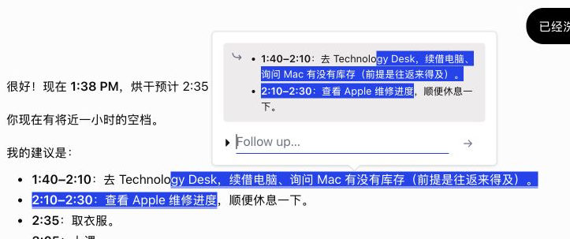</a> |
| R2 步骤卡片重复 | 选区跨两步，引用里第 3 步重复 | 每项一次，新的一项前面有序号「3.」 | <a href="evidence/step1/R2.png">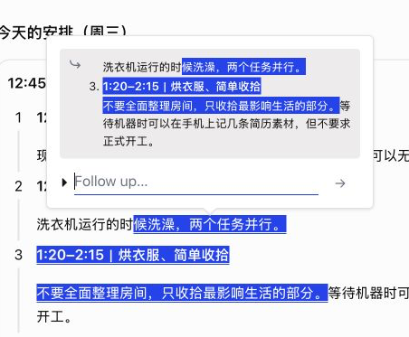</a> |
| R3 代码 | 页面代码没有高亮；引用是「PythonRunimport asyncio…」整块连成一段 | 页面上蓝底白字高亮，代码块没变；引用只有碰到的那一行，等宽、缩进保留 | <a href="evidence/step1/R3.png">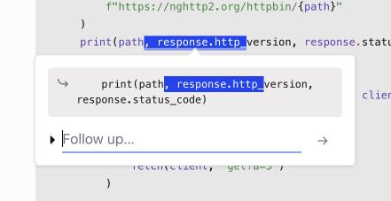</a> |
| R4 图表 | 选中坐标轴数字后图表坏掉（数字被截断或消失），popup 飞到页面底部 | 图表完好，选中的刻度蓝底白字，popup 在旁边，引用是「Chart: 标题」加选中的文字 | <a href="evidence/step1/R4.png">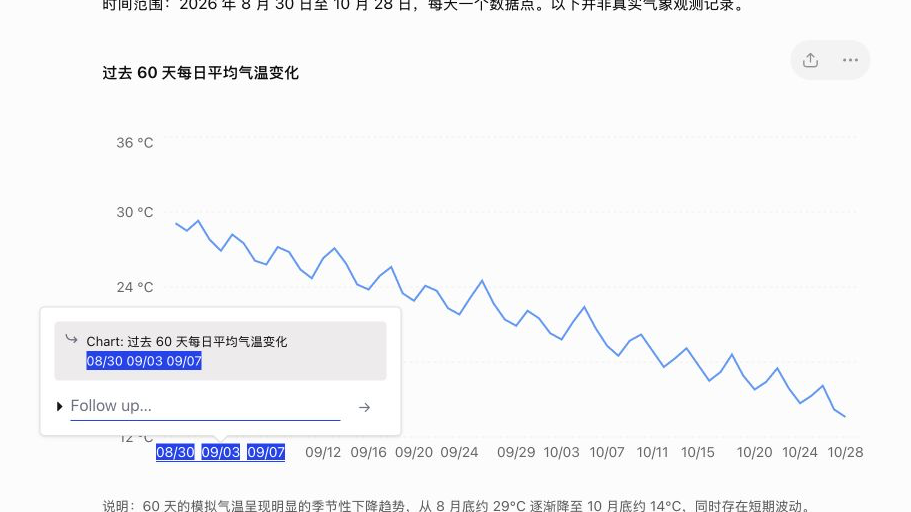</a> |
| R5 Reply 引用带「Reply」 | reply popup 的引用末尾是「…还是只是来打个招呼？ Reply」 | 引用以回答本身结束，没有「Reply」 | <a href="evidence/step1/R5.png">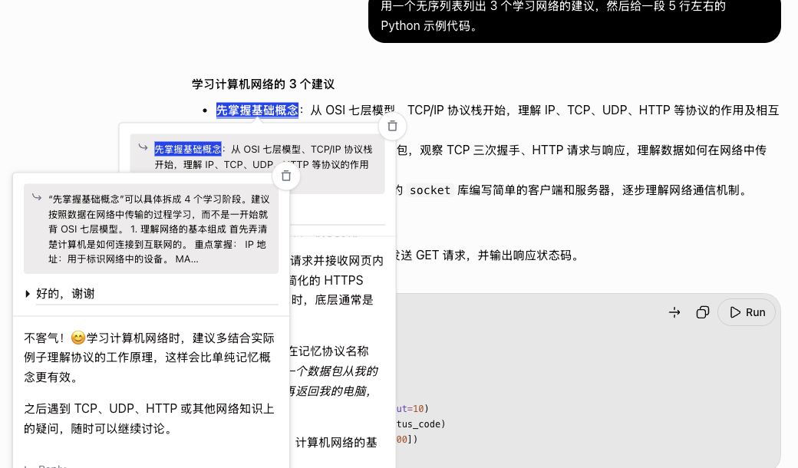</a> |
| R6 Reply 重复叠 popup | 再点 Reply 会叠出 4 层一样的 reply popup | 点两次 Reply，仍然只有原 popup 和一个 reply popup（2 层） |  |
| R7 刷新后「couldn't load」（排查过，不是 Popup） | 新格式的回答刷新后显示「This response couldn't load」 | 把 Popup 关掉后照样出现（图：Popup 关闭时三条回答都是 couldn't load），是 ChatGPT 自己的问题，不修 | <a href="evidence/step1/R7.png">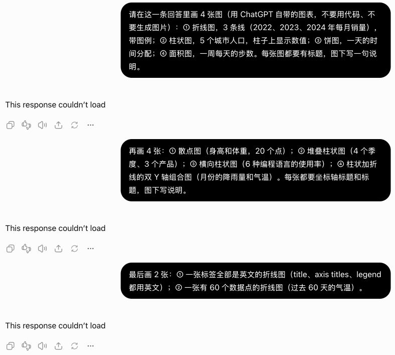</a> |
| R8 Popup 在所有页面都生效 | 在设置、GPTs、资料库等非聊天页面，Popup 也会尝试工作 | 只在网址带 `/c/<id>` 的对话里工作；其他页面选字不出 Popup 按钮（图：GPTs 页选中一句话，没有 Popup 按钮） | <a href="evidence/step1/R8.png">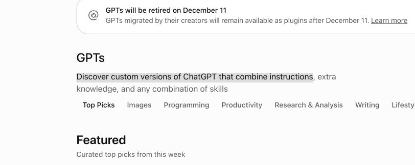</a> |
| R9 刷新后高亮没回来（测试时发现） | 回答内容晚到时，刷新后高亮没恢复，点不开原来的 popup | 从侧栏进入对话后高亮恢复，点开是原来的 popup（直接刷新那种情况被 ChatGPT 的 couldn't load 挡住，未能验证） | <a href="evidence/step1/R9.png">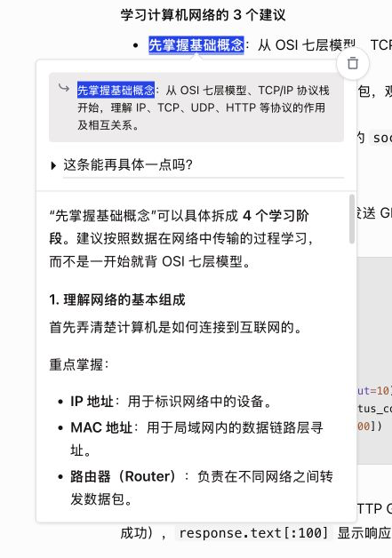</a> |
| R10 跨地图选字（盘点时发现） | 从地图上方拖到地图下方，地图上的评分和店名被涂蓝、变形，地图中间出现一条横线 | 地图完全不变，只有地图上下的两段标题是蓝底白字，引用只有这两段 | <a href="evidence/step1/R10.png">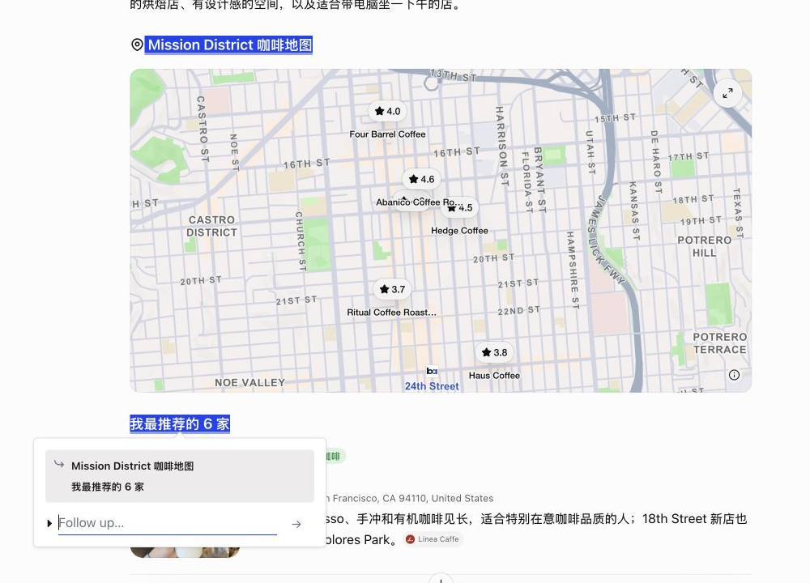</a> |
| R11 点 Popup 按钮打开了文件预览（排查过，不是 Popup） | 在 CSV 下载链接上选字后点 Popup 按钮，右边打开了文件预览 | 从链接里面开始拖选就会打开，完全不碰 Popup 也一样（图：拖选后只按了 Esc，没有 popup，预览照样打开），是 ChatGPT 的链接行为，不修 | <a href="evidence/step1/R11.png">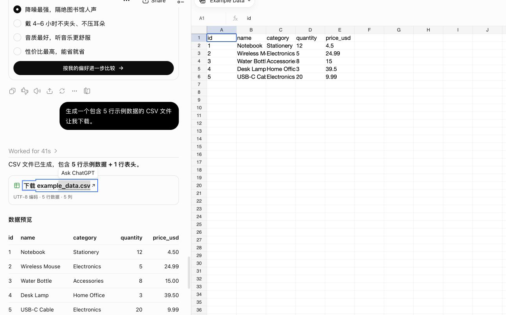</a> |
| R12 单个列表项的引用没有 bullet（收集证据时发现） | 只选列表里的一项时，引用里没有 bullet | 引用里这一项前面有 bullet |  |
| R13 富格式回答显示组件标签 | 刷新后 popup 回答里出现 `<box …>`、`<icon …/>` 等原文 | 画成卡片、两栏、标签和符号，没有标签文字 | <a href="evidence/step1/R13.png">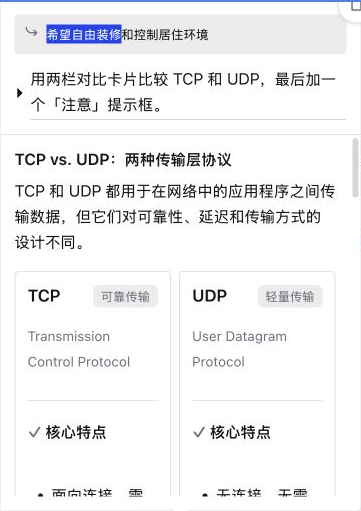</a> |

### 检查过、正常的格式（F4，2026-10-28）

| 格式 | 检查结果 | 截图（点开看大图） |
|---|---|---|
| 表格 | 选中单元格里的一段：只高亮那一段，引用是这个单元格的内容 | <a href="evidence/step1/formats-checked/1-table.png">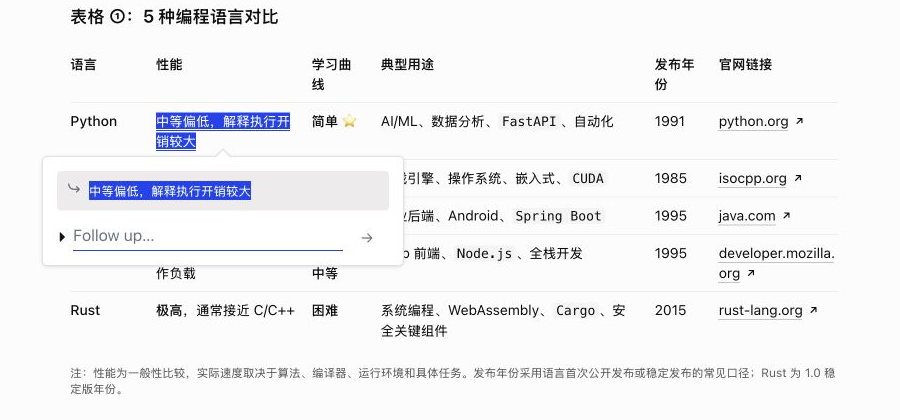</a> |
| 12 列宽表 | 选中表头单元格里的字，引用正确，横向滚动不受影响 | <a href="evidence/step1/formats-checked/1-wide-table.png">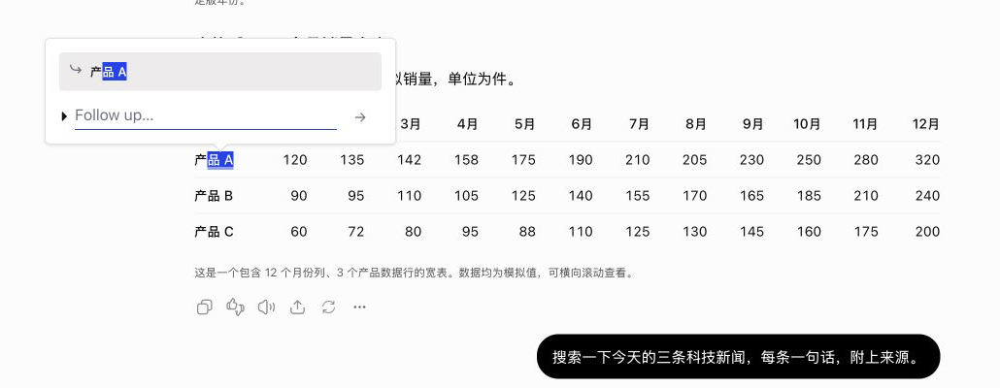</a> |
| 联网搜索的来源 | 正文连同来源小标签一起选中，引用里来源只出现一次 | <a href="evidence/step1/formats-checked/2-source-badge.png">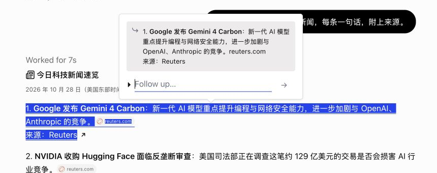</a> |
| 图片下面的说明文字 | 选中图片下面的文字，图片不受影响 |  |
| 图片本身 | 选不了字，不涉及 Popup |  |
| 天气卡片 | 选中卡片里的文字，卡片布局不变 | <a href="evidence/step1/formats-checked/4-weather.png">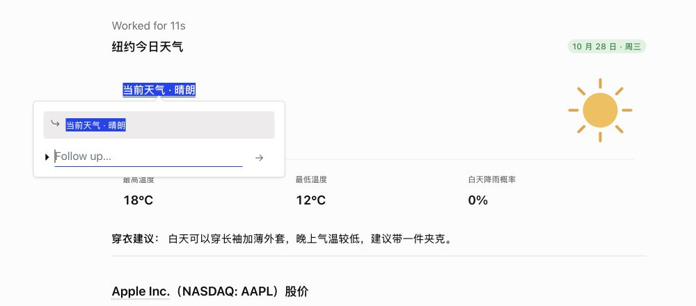</a> |
| 股价卡片 | 同上 | <a href="evidence/step1/formats-checked/4-stock.png">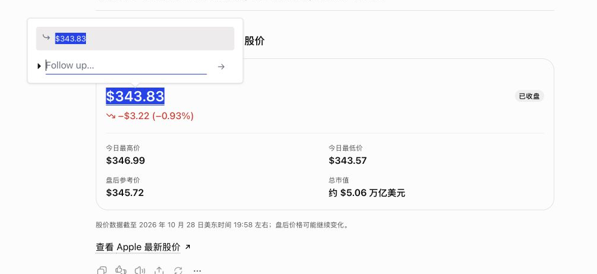</a> |
| 商品推荐 | 选中商品标题，卡片和图片不受影响 | <a href="evidence/step1/formats-checked/6-product.png">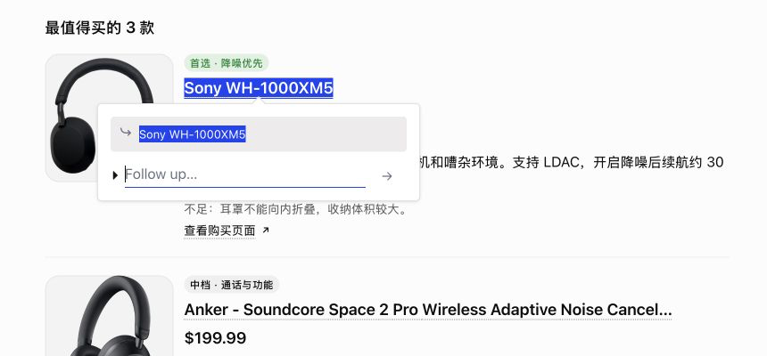</a> |
| 单选按钮组 | 选中选项文字，按钮照常可点 | <a href="evidence/step1/formats-checked/6-radio.png">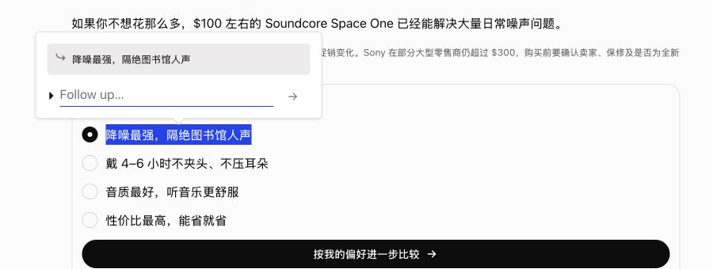</a> |
| 文件附件卡 | 选不了字，不涉及 Popup | <a href="evidence/step1/formats-checked/8-attachment.png">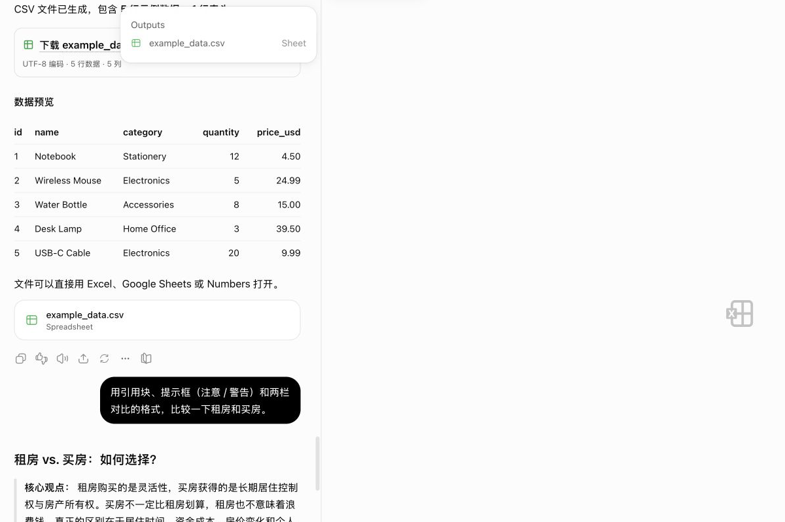</a> |
| 引用块 | 选中引用块里的文字，引用正确 | <a href="evidence/step1/formats-checked/9-blockquote.png">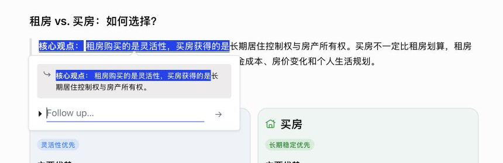</a> |
| 「注意」提示框 | 选中提示框里的文字，框的样式不变 | <a href="evidence/step1/formats-checked/9-notice.png">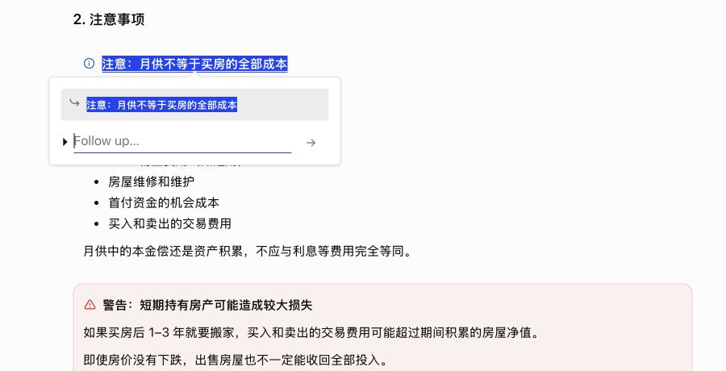</a> |
| 「警告」提示框 | 同上 | <a href="evidence/step1/formats-checked/9-warning.png">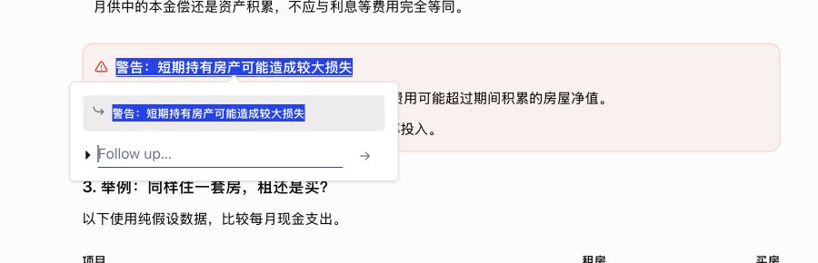</a> |
| 两栏对比 | 选中一栏里的列表项，引用带 bullet（dev.10） | <a href="evidence/step1/formats-checked/9-two-columns.png">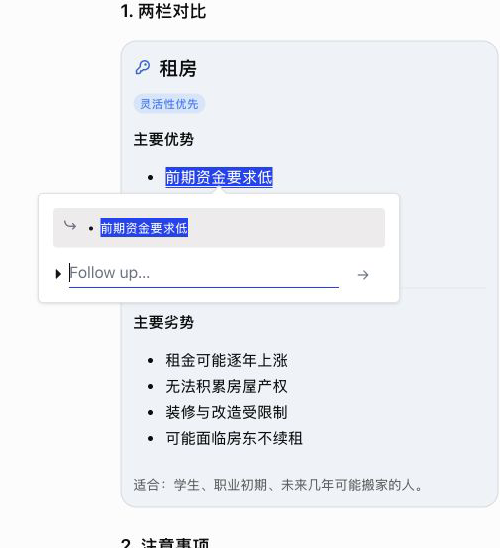</a> |

### popup 里的回答格式（R14，T15–T17，2026-10-29）

| 格式 | 现在 | 截图（点开看大图） |
|---|---|---|
| 代码块（刷新后） | 真代码块，换行和 `**` 都在，有 Copy，长行在块内横滚 | <a href="evidence/step1/R14-formats/code.png">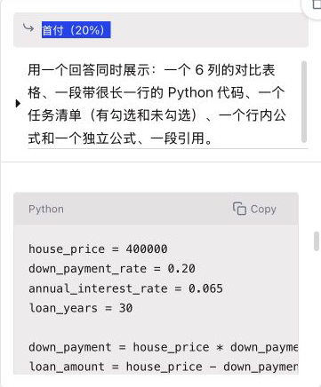</a> |
| 图表（刷新后） | Popup 按回答里的数据画折线图，有坐标轴和年份 |  |
| 图表（刚生成） | 不再是空白：三条折线 |  |
| 地图 | 地点列表：图标、名字、地址、Map 链接 | <a href="evidence/step1/R14-formats/map.png">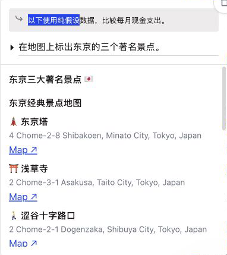</a> |
| 任务清单（带脚本） | 看得见的勾选框，前两项已勾，「2 / 6 已完成」 | <a href="evidence/step1/R14-formats/tasks.png">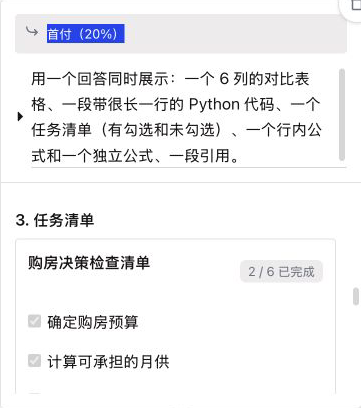</a> |
| 6 列表格，窄 popup | 不越界，表格区域横向滚动（这张已滚到最右） | <a href="evidence/step1/R14-formats/table-narrow.png">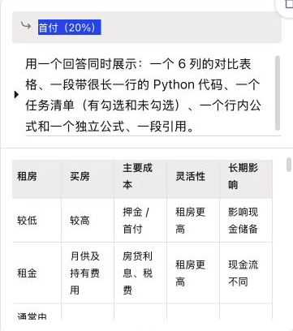</a> |
| 6 列表格，拉宽到 720px | 6 列完整，不变形 | <a href="evidence/step1/R14-formats/table-wide.png">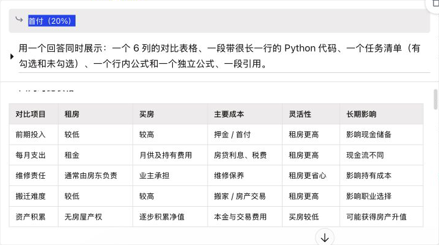</a> |
| 来源链接 `<Link>` | 可点的链接 |  |
| 柱状图（生成中和刚生成） | 生成中一直是 Popup 画的图，没有闪成空白；5 根柱和刻度 |  |

## Step 2: Attachments in Popups (ChatGPT) — DONE, verified live (1.2.11-dev.12), released in 1.2.11
- Design (grilling 2026-10-29, `collab/PLAN-next.md` "grilling 结论"): any file; images as thumbnails, other files as an icon with the extension, in a row of squares between the quote and the question; question text required; edits start with no attachments; files ChatGPT does not take are dropped and listed in a grey note (this session only); Retry resends files still in memory, after a reload only the text; storage keeps a count only; no Popup send while the user's own files wait in ChatGPT's input box
- 2a input takes pasted / dropped files — 2b hand-over to ChatGPT's composer (synthetic paste, upload wait, renamed and same-named files) — 2c attachments on answered popups, per version, and after a reload (conversation data + /backend-api/files/download, HTTP 200 verified)
- Two independent ponytail reviews, all findings fixed (1.2.11-dev.1, dev.6); live tests T6–T10

### Step 2 evidence (1.2.11-dev.12, live tests T7–T13)

| 情况 | 现在 | 截图（点开看大图） |
|---|---|---|
| 粘贴进 popup 的附件 | 引用框和输入框之间单独一层，一样大的 45 px 小方块：图片是缩略图，其他文件是图标加文件名（`clip….pdf`、`clip….zip`，扩展名完整） | <a href="evidence/step2/1-strip.png">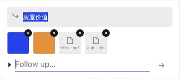</a> |
| 两张同名图 + PDF 发出去 | 回答完成后附件还在；ChatGPT 收到了三个附件（回答逐个说出了蓝、橙和 PDF 里的字） | <a href="evidence/step2/2-sent.png">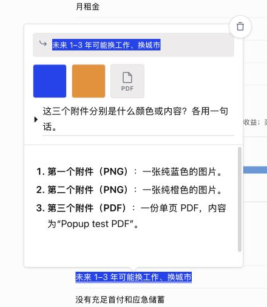</a> |
| 编辑并换附件 | 编辑从空白开始；第 2 版只带新贴的橙图，回答「橙色」；版本切换时附件跟着换 | <a href="evidence/step2/3-edit-v2.png">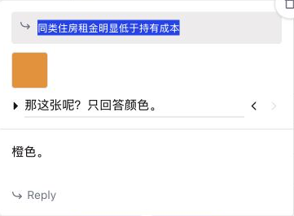</a> |
| 刷新后 | 缩略图和 PDF 方块都恢复（图片地址接口 HTTP 200；和上一行同一张图，拍时页面已刷新） | <a href="evidence/step2/4-reload.png">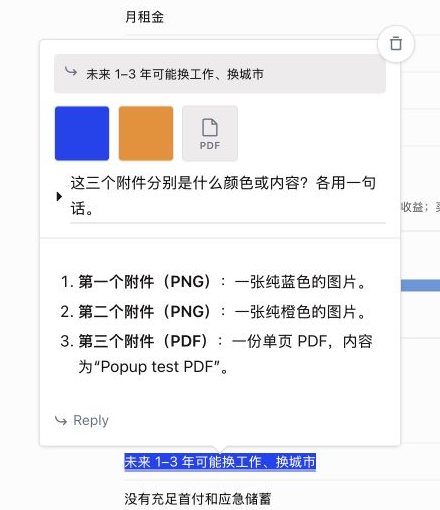</a> |
| 你自己的附件在 ChatGPT 输入框里 | Popup 不发送；附件那一层（引用框和问题之间）一行「Send or remove your files in ChatGPT’s box first」，离引用 10 px、离问题 6 px；问题和附件都留着 | <a href="evidence/step2/5-blocked.png">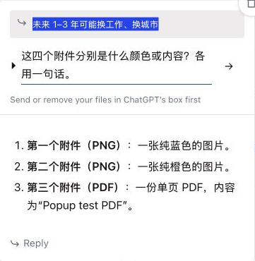</a> |
| ChatGPT 不收的附件（空文件） | 问题和其余附件照发（回答「蓝色」）；附件方块下面一行「Not sent: clipboard.plain」（原因在悬停提示里），离方块 3 px、离问题 6 px，左边和方块对齐 | <a href="evidence/step2/6-not-sent.png">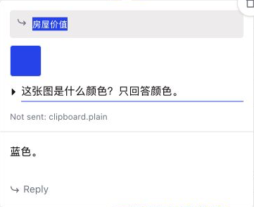</a> |

## Step 3: Popup Height, Direction and Answer-Format Gaps (ChatGPT) — CURRENT
**User reports log: [REPORTS.md](REPORTS.md). Fixed eval set (re-run after every change): [EVALS.md](EVALS.md).** Status 2026-11-17 evening (1.2.13-dev.27): R36b/c/e/f/g fixed (live: b/f/e; c/g offline only), R36i (above popup jitter) fixed and confirmed by the user, R36j (follow the answer to its end) fixed, R36h decided by the user — typewriter (dev.27, user: "可以了"); **open: R36a** (root cause measured, fix to try: hide the new turn with height 0 + width kept instead of `display:none`; first redo the A/B R6), then the full eval set + ponytail-review.
Reported 2026-10-30 (popup too short to read; grey bar in a card). Measured live by the operator (P2, P3; 1.2.11, no messages sent). Design settled with the user in 4 grilling rounds (2026-10-30). Flow per fix: offline test red → fix → green → ponytail review → 1.2.12-dev.N → user reloads → operator verifies → evidence below.

Checklist (R1–R14 are Step 1, so numbering continues):
- [x] R15 (reported) a card's "relative size" bars after a reload are all the same full-width empty grey strip (looks unloaded): Popup's renderer keeps only `width="100%"` (`src/qa-content.js` dilOpen) — draw each bar at the width the answer gives (CPU short, RAM medium, SSD full); Popup's grey — fixed 1.2.12-dev.3, verified P6
- [x] R16 (reported) popup too short: answer area 121–166 px on a 603 px window (P2) — every popup with an answer may be up to 70vh tall by default (compact before it, R25; as tall as its content, R26); no `520px` cap; `--jr-popup-cap` removed: height is never cut to fit the screen — fixed 1.2.12-dev.2/dev.4, verified P6/P9
- [x] R17 attachments + question share one scroll area, at most 4 question lines (~102 px) together; quote stays at max 6 lines — fixed 1.2.12-dev.4/dev.7, verified P6/P9
- [x] R18 direction: both sides reachable by scrolling → the side with more room on screen at open time; only one reachable → that side; neither (very short chat) → below (the popup extends the page; P3: ChatGPT adds no bottom padding after a reload); never moves while the answer streams; no auto-scroll on open — fixed 1.2.12-dev.2, verified P6/P9 — **changed 2026-11-18 (dev.48, user): the side with more room on screen now; above only if the chat can scroll up far enough, else below**
- [x] R19 drag the edge away from the highlight to change height, 40vh–70vh; only the answer area changes (quote, attachments, question keep their size); kept for the rest of the session, like width (not stored) — fixed 1.2.12-dev.2, verified P6/P9
- [x] R20 drag the two corners on that far edge to change width and height together (below: bottom corners; above: top corners, the trash button keeps its click area) — fixed 1.2.12-dev.2, verified P6/P9
- [x] R21 window resize: an open popup keeps its vh share (a dragged height keeps its percentage); answer area never below 3 lines (~80 px) — on a tiny window the popup stops at that minimum instead of collapsing — fixed 1.2.12-dev.2, verified P6/P9
- [x] R22 (found while testing, P2) template loop values shown raw in a popup answer (`地址 {cell.a}`, `{cell.v}`) — fixed 1.2.12-dev.3, verified P6
- [x] R23 nested popups (level 2+) follow R16–R21 the same way; parent and child popups both stay on their highlights after a window or layout change — fixed 1.2.12-dev.6/dev.8, verified P8 (scrolling far and back: see R24)
- [x] R24 (found while testing, P10) scrolled far away and back in a long chat, a highlight is gone: ChatGPT rebuilds the turn with an empty answer and fills it in later; the "answer filled in, look again" rule ran only for highlights never restored before (`src/qa-content.js` mount observer) — it also runs for highlights lost from that turn — fixed 1.2.12-dev.9, verified P11
- [x] R25 (reported 2026-10-31) an empty popup (writing the question) was already 70vh, a tall blank box: only a popup with an answer is 70vh; writing the question, waiting for the answer (it grows when the first words arrive) and the delete confirmation are compact as before Step 3; the side is still chosen for the 70vh answer; height drag only with an answer — fixed 1.2.12-dev.10, verified P12 (waiting → grows at the first words: offline test only, no message approved)
- [x] R26 (reported 2026-10-31) a short answer still got a 70vh popup with blank space under it: a popup is as tall as its content up to 70vh (or the dragged height); while the answer streams it grows step by step until it reaches that height, then the answer scrolls; a short answer stays short; the 3-line answer minimum on a tiny window stays (R21) — fixed 1.2.12-dev.11/dev.12, verified P13
- [x] R27 (reported 2026-10-31) editing a question, the send menu's first item (Detailed) was a blank white row: the answer's white scroll-fade edge (a sticky ::before with a 50px shadow, z-index 1) painted over the send row (sticky, z-index 1, earlier in the page) — the send row is z-index 2 (P12b) — fixed 1.2.12-dev.13, verified P13
- [x] R28 (reported 2026-10-31) switched to another desktop and back, the edit typed into a popup's question was gone: losing focus ended the edit and put the old question back (P12b: 101 ms after a blur) — losing focus keeps the edit; only Esc or closing the popup gives it up (decided with the user) — fixed 1.2.12-dev.13, verified P13 (a blur inside the page; a real desktop switch can't be driven by the operator)
- [x] R29 (reported 2026-10-31; audit #12) pasting an image copied from a web page into a popup did nothing: the clipboard holds an `` tag (text/html) and the picture but no text, and any text/html counted as a text paste (P14 reproduced it) — only text/html with text is a text paste — fixed 1.2.12-dev.15, verified P15 (text with HTML still pastes as text; a plain picture still works)
- [x] R30 (reported 2026-10-31) a file dragged onto a popup went to ChatGPT's composer: ChatGPT handles file drags over the whole page — Popup now takes every drag event first (early-hide.js, document_start, before ChatGPT's scripts): over a popup the file goes to its question (outlined while dragging), ChatGPT never sees the drop; ChatGPT's "Add anything" layer goes away as soon as the file is over a popup and after the drop (user, dev.15: it stayed; Popup now sends ChatGPT a dragleave on entering a popup, and a dragleave + empty drop after the drop — P16 couldn't find ChatGPT's code, so this follows the usual pattern); elsewhere ChatGPT handles it as before. The operator can't drag files: user check — fixed 1.2.12-dev.15/dev.17, verified by the user (2026-11-01); its look (drop outline) to be polished later (user: works, but ugly)
- [x] R31 (reported 2026-10-31) text highlighted inside a "Writing" block of an answer shows no highlight (the popup's quote does): the block is a ProseMirror editor (`[data-testid="chatgpt-writing-block"] .ProseMirror`, contenteditable) and removes the span (P17) — painted like code blocks instead (Highlight API + a transparent proxy in the block), the editor's text is never touched — fixed 1.2.12-dev.17, verified P18. Reopened (user, 2026-11-01): blue for a second, then only the underline — the editor redraws its text a moment later and the painted range collapses; the block's text is now watched and the paint follows the new text — fixed 1.2.12-dev.23, user check
- [ ] R32 (reported 2026-11-01) lag: popup closed itself when an answer started, the page wouldn't scroll, a popup took several clicks to open (P19, 2 messages: not reproduced; review + two energy audits, against 1.2.11 and 1.1.3) — fixed: a popup ChatGPT re-rendered away goes back next to its highlight (else counts as closed); idle restore slices yield on a busy page and skip known misses; keyless 1.1.3 highlights no longer wake a restore on every streamed word; `::highlight` scoped to the blocks that use it; no layout read per DOM change (`checkVisibility`); network answer drawn once per frame; diagnostics only with a `#jr-` hash; one placement path, no per-popup resize listeners, no per-frame re-placing while streaming. Scrolling up while an answer streams pulled the page back (the popup's answer was unmounted while scrolling, the lock then used its old position) — fixed. 1.2.12-dev.19–dev.24; synthetic tests only (real ChatGPT not measured); user check. Note: the user's Mac (8 GB, 8.3 GB swap in use, 2026-11-01) lags on its own — compare with Popup off before blaming Popup
- [ ] R33 (reported 2026-11-16) sending from a popup threw the page away from the highlight (Return: both off screen; arrow / Reply / edit: page moved, popup detached; then "flashes, jumps up and down a few times"). Root causes, all measured live (T2–T18, frame snapshots read by Apple Events, sends by Codex Computer Use): (1) the scroll lock took the Return / send-arrow press inside the popup for the user scrolling and stood still 800 ms (Return removes the question box before the event bubbles, so `e.target` is detached — fixed with `composedPath`); (2) each send path passed its own anchor — Reply had none, edit/retry passed stale spans; (3) after a send ChatGPT's virtual list re-estimates turns outside its window (heights swap to ~160–210 px placeholders and back; on the first send after a load it drops and re-creates turns), and the lock corrected one frame late (rAF) and stored positions measured in that collapsed list. Design now (1.2.13-dev.16): every send goes through the queue → `JR.prepareSend` (no send path can skip it); `JR.viewAnchor()` is the one place that picks the anchor (root highlight of the open popups, else the first turn on screen); `scroll-guard.js` blocks ChatGPT's own thread scrolls while a send is in flight; `JR.lockScroll` keeps the anchor turn at the same screen position, corrected in a ResizeObserver (after layout, before paint — a shifted frame is never drawn), rAF as fallback, and returns to the send-time position when the anchor turn is gone. Verified dev.14 (same logic as dev.16), first send after a page load: Return, send arrow (at a boundary between answers), Reply, edit — highlight moved 0 px in every recorded frame (SMOOTHNESS 0 ms), no blank or jump seen by Codex (E5–E8); second send on a page: 0 ms (E3). Tried and reverted: letting ChatGPT scroll (dev.4/dev.7: bounce), letting only non-bottom scrolls through (dev.11), re-sending a scroll event after a blocked scroll (dev.9/dev.15: more re-renders). Known left: when the end of the previous answer is on screen above the highlight's answer, ChatGPT shows that strip as its own placeholder for ~80 ms on the first send after a load (its virtual list, not Popup; the highlight and popup don't move); offline tests in tools/dom-test.html (R33 ×6)
- [ ] R34 (reported 2026-11-16, for later — after R33) popup answers show ChatGPT's formats as raw source: a formula as TeX (`\[x=[HRV,\ RHR,\ RR,\ Temperature,\ldots]\]`), a drawn diagram as its `<svg viewBox…>` template with unevaluated `{d.x+9}` / `M${d.x+44}` expressions (screenshot from the user, an XGBoost answer). User: ChatGPT changes its answer markup every week and Popup's own renderer (`JR.renderMarkdown`) has to chase it — asks to reuse ChatGPT's own rendering in the popup instead. This reverses the 2026-10-29 decision ("Popup draws answers itself"), so it needs a design round first. Facts for that round: fresh answers are already a copy of ChatGPT's rendered HTML; after a reload Popup's turns are filtered out of ChatGPT's data (net-tap, so the chat has no gaps), so ChatGPT never renders them and there is no HTML to copy. Options: (a) keep the copy made while streaming (storage was keys-only by design: size, privacy); (b) let ChatGPT render the hidden turns and copy their DOM (virtual list renders only turns near the screen; the filter exists to avoid gaps); (c) call ChatGPT's own renderer (internal, likely just as fragile). User (same day): "streaming looks perfect, it breaks once it's fixed" — keep the streaming result in the popup. Found: while streaming the popup mirrors ChatGPT's live DOM (`syncAnswerInto`); at the end `rebuildPopupAfterEdit` rebuilds the popup from a string (the turn's `innerHTML`, or `JR.renderMarkdown(net.text)` when the hidden turn isn't in the DOM — ChatGPT re-creates every turn after a send, R33/T14) plus Popup's post-processing (`rebuildCodeBlocks`, links, images); after a reload always `JR.renderMarkdown`. Plan: (1) at the end keep the streamed DOM as the answer (no rebuild), save its HTML for reopening; (2) to look the same after a reload, store that HTML (reverses keys-only storage: needs the user's OK; size ~KBs per answer, 10 MB quota or `unlimitedStorage`). **User: no — Popup never stores answer content.** Measured (T17, operator2, no messages): CSS-only hiding (no net-tap filter) still costs 13 px per hidden Q&A (a 1 px `[data-measured-turn]` row + 12 px gap; 30 in a row = 402 px blank), ChatGPT does render the full answer inside a hidden turn (mirrorable), but Popup Q&As sit at the thread's end in send order, so with each highlight centred only 3 of 52 Q&A turns were in the DOM. Root cause: after a reload ChatGPT never renders a Popup answer near its highlight (filtered out of its data; and even unfiltered, the virtual list mounts it only near its chronological place), so Popup must redraw the Markdown itself and chase ChatGPT's formats. Plan: (A) in the session: no rebuild at the end — keep mirroring until ChatGPT's turn is done and keep that DOM in memory for reopening (nothing stored); delete the finish rebuild + post-processing path. (B) after a reload: ChatGPT renders on demand — a hidden same-origin iframe of the conversation (`#jr-nofilter`; ChatGPT's CSP allows `frame-ancestors 'self'`), where Popup scrolls its own (invisible) list to the needed turn, copies ChatGPT's rendered answer and posts it to the page; one iframe per conversation, created on the first popup that needs it, dropped when idle; nothing stored. `JR.renderMarkdown` shrinks to a plain-text fallback. Open: does ChatGPT behave normally when framed; memory/CPU on an 8 GB Mac; extra conversation load per page session. Also try: hide the whole `[data-measured-turn]` row (not just the turn) — if that removes the 13 px, net-tap's filter + parent rewrite could be deleted. **Root cause in the session too (T19, 2026-11-16):** the hidden Q&A turn is mounted while it streams (newest turn) but ChatGPT's virtual list drops it soon after, so at the end Popup fell back to `JR.renderMarkdown` (raw TeX, its own table/code). **Done (1.2.13-dev.17): plan B** — `src/chatgpt-render.js` (`JR.chatgptRender(turnKey)`: hidden same-origin iframe `.jr-render-frame`, Popup doesn't run in frames so nothing is filtered there; scrolls the frame's list to the turn, waits until the text is stable, returns ChatGPT's HTML; one frame per conversation, queue, dropped after 60 s idle; frame selectors in site-adapter), `JR.qa.upgrade` (after `JR.qa.ensure` and when `captureResponse` had to use `renderMarkdown`) and `JR.onQAUpgraded` (swaps the answer in memory, redraws the open popup). Verified T20 (dev.17, after a reload, no message): the T19 answer opened already as ChatGPT's rendering (5 KaTeX formulas, ChatGPT's table, no Popup renderer marks), frame gone afterwards. Left: ChatGPT's tables keep their content width in a popup (~260 of 330 px); `rebuildCodeBlocks` still replaces ChatGPT's highlighted code block with Popup's plain one (keep ChatGPT's and wire its Copy button instead); first upgrade costs one hidden ChatGPT page load (~12 s, in the background)
- [ ] R36 (reported 2026-11-17, 8 items a–h, plus i–j later) — details, evidence and status per item in [REPORTS.md](REPORTS.md) "R36"; R36a fixed dev.28–30 (live E-send-1…7 0 ms); open: E-render-7 (user decision), dark-mode run before release
- [x] R35 (reported 2026-11-16) a secondary popup (text selected inside a popup answer) needed 4–5 clicks to open: a press on the trigger button's icon started a new selection (the answer area is user-select: text), the old selection collapsed, the selectionchange handler removed the button before mouseup, so no click (T21: mousedown on the svg, no click; a press on the button's edge worked) — the button's mousedown now prevents the default (the selection stays) — fixed 1.2.13-dev.19, verified T22 (3 of 3 opened on the first click on the icon). Reply popups were not affected (T21 A)
- [x] Retake every Step 3 screenshot (R15–R28) on the final build (user, 2026-10-31: several no longer match) — done on 1.2.12-dev.13 (P13, P13b; 2 approved messages used); the popup mid-growth (R26) streams too fast to capture, numbers only
- Checked, not changed: the question already scrolls after 4 lines (P2: scrollTop 0→54; the Mac scrollbar shows only while scrolling); width rules (280–720 px drag) unchanged

### Step 3 evidence

| # | 问题 | 现在 | 截图（点开看大图） |
|---|---|---|---|
| R15 | 卡片里的相对容量横条刷新后全是一样长的空灰条 | 按回答写的宽度画：CPU 12%、RAM 52%、SSD 100%（实测 0.12 / 0.52 / 1.0），卡片有内边距 | <a href="evidence/step3/R15-bars.png">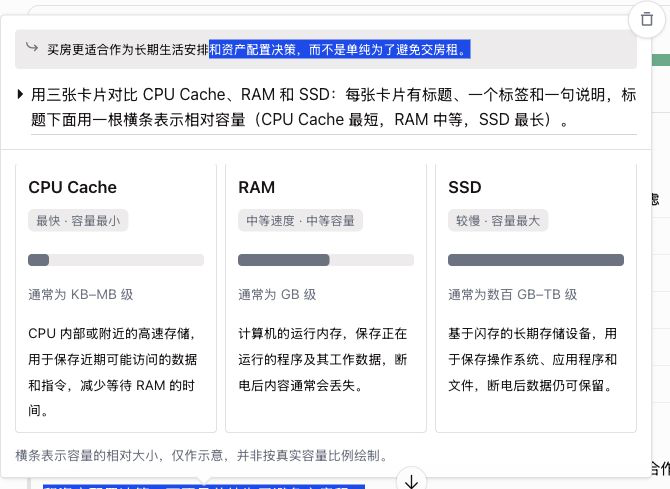</a> |
| R16 | popup 太矮，回答区只剩一两行 | 长回答的 popup 是 70vh（659px 窗口实测 461px），回答在里面滚动（可见 265px / 共 8630px），不再被压矮 | <a href="evidence/step3/R16-long.png">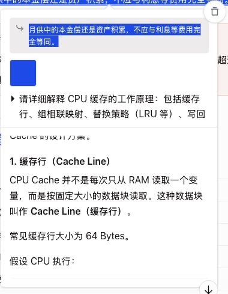</a> |
| R17 | 附件和问题一起占太多高度 | 附件和问题一起滚动，合起来最多 4 行问题的高度；▸ 在第一行；发送箭头和 Detailed/Concise 菜单不被裁 |   |
| R18 | 往上开时顶部被截、往下开时被压矮 | 上下都滚得到时看高亮在屏幕上的位置：高亮在上部（25%）往下开，在下部（75%）往上开；贴着高亮（偏差 ≤ 0.3px） | <a href="evidence/step3/R18-below.png">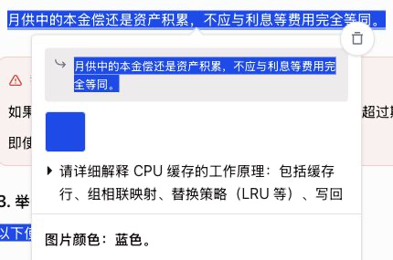</a> <a href="evidence/step3/R18-above.png">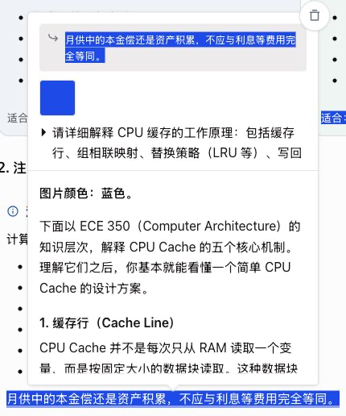</a> |
| R19 | 高度不能拖 | 拖离高亮远的那条边：461 → 361px，只有回答区变；下限 40vh（或"引用+问题+3 行回答"），上限 70vh；只有回答长到上限时才能拖高度 | <a href="evidence/step3/R19-drag.png">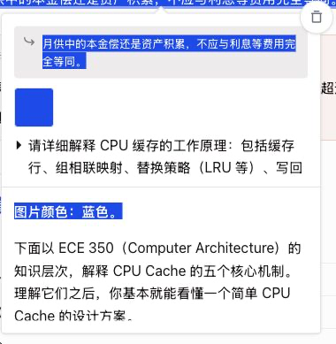</a> |
| R20 | 不能拖角同时改宽高 | 拖远边的角：360×361 → 320×311 | <a href="evidence/step3/R20-corner.png">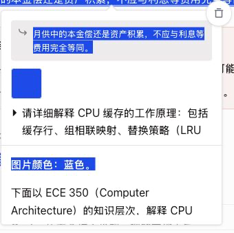</a> |
| R21 | 窗口变小时 popup 被压扁 | 500px 窗口里长回答 popup 是 350px（70vh），窗口变回 659px 是 461px；回答区至少 3 行 | <a href="evidence/step3/R21-small.png">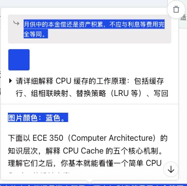</a> |
| R22 | 回答里出现 `{cell.a}` 原文（测试时发现） | 8 格网格，每格地址和值都填上，没有 `{`、`cell.` 原文 | <a href="evidence/step3/R22-grid.png">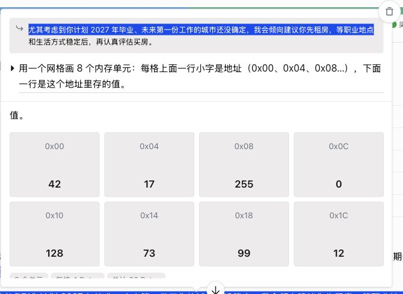</a> |
| R23 | 嵌套 popup 同样规则 | 子 popup 贴着它在父回答里的高亮（偏差 0.27px），父 popup 贴着自己的高亮；子回答只有一句，所以子 popup 是短的（见 R26） | <a href="evidence/step3/R23-nested.png">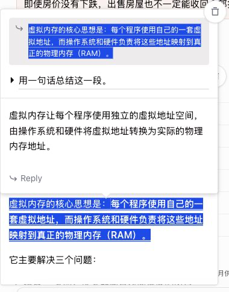</a> |
| R24 | 长对话里滚远再滚回来，高亮没了（测试时发现） | 那一轮被 ChatGPT 卸掉（DOM 里 0 个）再滚回来，高亮在约 3.5 秒内回来；开着的 popup 也贴着它 |  <a href="evidence/step3/R24-popup.png">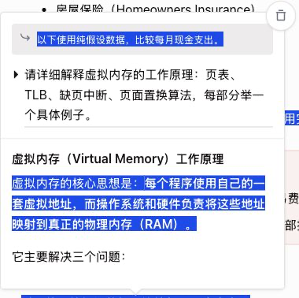</a> |
| R25 | 还在写问题时 popup 就是 70vh，下面一大片空白（用户报告） | 没有回答时和以前一样紧凑：写问题 108px（就是引用+输入框）；等待回答 184px（问题 134 + 等待行 50）；删除确认 44px；对话最底打开的新 popup 按回答的高度往上开 | <a href="evidence/step3/R25-compose.png">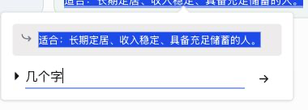</a> <a href="evidence/step3/R25-waiting.png">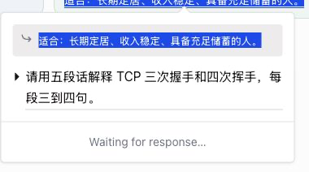</a> <a href="evidence/step3/R25-confirm.png">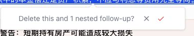</a> <a href="evidence/step3/R25-bottom.png">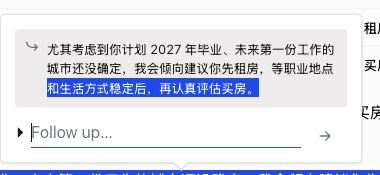</a> |
| R26 | 回答很短时 popup 还是 70vh，下面一片空白（用户报告） | 短回答：popup 305px = 问题 147 + 回答 157，回答区下面没有空白；流式输出时高度只增不减，到 70vh 停住，回答在里面滚动（两次实测：184 → 188 → 345 → 461；229 → 458 → 461；完成后 282 / 1432px）。长高的中间状态太快，截图工具拍不到，只有数值 |  <a href="evidence/step3/R26-full.png">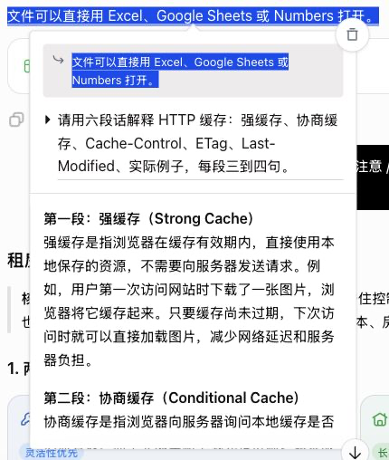</a> |
| R27 | 改问题时发送菜单第一项（Detailed）是一行空白（用户报告） | 编辑已有回答的问题时，Detailed 和 Concise 两项都看得见 | <a href="evidence/step3/R27-menu.png">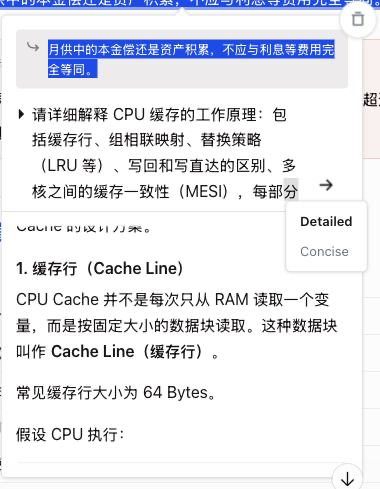</a> |
| R28 | 切到别的桌面再回来，改到一半的问题没了（用户报告） | 编辑中输入框失去焦点 3 秒后仍在编辑，加的字还在；按 Esc 才恢复原问题（真正切桌面 operator 做不到，未测） |  |
| R29 | 从网页复制的图片粘贴进 popup 没反应（用户报告） | 剪贴板里是 `` 标签 + 图片、没有文字时，图片进 popup 的附件；带文字的（Word、Excel、网页文字）照旧粘贴成文字 |  |
| R30 | 把图片拖到 popup 上，被 ChatGPT 当成给它的（用户报告） | 用户实测：文件进了 popup 的问题，ChatGPT 没收到（拖动时的样子以后再改） | — |
| R31 | 「Writing」块里选的字没有高亮（用户报告） | 选的词蓝底高亮（和文字位置偏差 0px），popup 贴着它；块里的邮件正文一个字没动；关掉 popup 后不留痕迹 |  |

## Step 4: DeepSeek + claude.ai Support — design done, browser checks done, wired in 1.2.13-dev.32 (offline tests pass); live evals next
Decisions (user, 2026-11-17): DeepSeek supports everything ChatGPT has; DeepThink/Search sent as the user set them; DeepSeek and claude.ai released together in one version; popups on every site show only the reply (no DeepThink reasoning, no claude.ai status line "Searched the web"/"Thought for…"); DeepSeek forbids iframes and a background window was rejected → mirror DeepSeek's DOM while the turn is on the page, after a reload Popup renders the Markdown with DeepSeek's own classes; claude.ai: blank flash fixed by hiding with `height:0` + width kept (live: 0 of 22,687 frames), never rewrite its protobuf data.
Progress: adapters + tests `src/sites/deepseek.js`, `deepseek-net.js` (tools/dom-test-deepseek.html 37/37), `src/sites/claude.js` (tools/dom-test-claude.html 22/22); live browser checks B1–B9 (DeepSeek) and C1–C6 (claude.ai) recorded in docs/DEEPSEEK.md and docs/CLAUDEAI.md. Not yet loaded by manifest.json — **next after R36a: the shared-file refactor (DEEPSEEK.md §8, CLAUDEAI.md §8), then wiring, then live evals.** Left to check: claude.ai upload-in-progress marker (big file). Found: DeepSeek also jumps to the bottom on send and a listener installed after load sees no requests → its net tap and scroll guard must run at `document_start`.
- 4a Refactor without changing ChatGPT behavior: pick the site by URL, one conversation-id rule, per-site storage key prefix
- 4b DeepSeek adapter (`src/sites/deepseek.js`) and network listener (`src/sites/deepseek-net.js`)
- 4c Read back answers not on screen (`history_messages`)
- 4d Live tests (4 approved messages left), light/dark, full ChatGPT regression
- claude.ai: decide after DeepSeek (CSS hiding flashes blank space while scrolling)
- 4e (user, 2026-11-19, all three sites, before release) **Keep the draft in the main input box**: a Popup send while the user has half a message typed — or files / images — in the site's own box sends only the Popup question (never the draft, never those files), and the box shows the draft unchanged during and after the send — at least put back right after the send. Also on a failed send. **Not in this release (user, 2026-11-19):** the text part (dev.147, offline test only) is kept in `collab/patches/4e-draft-text.patch` (`patch -p0 < …`), out of the code from dev.148. Files and the look during the send: not started.
  - Today: `insertIntoComposer` (src/chat.js) inserts at the caret — on ChatGPT / claude.ai the draft is sent along, then cleared by the site; DeepSeek's textarea is overwritten (draft lost). Files in the box: the send is refused ("Send or remove your files … first", `JR.blockedByComposerAttachments`).
  - Text: before the insert read the draft (innerText: keeps line breaks; textarea value), select all + insert (the message replaces it); refuse to send if the draft is still there (length check, whitespace stripped — Markdown input rules may drop characters); when the site has cleared the box (`removeHideWhenEmpty`) put the draft back the same way, caret at the end, the box still hidden until then; then blur. The "landed" probe must strip all whitespace (ProseMirror's textContent has no line breaks).
  - Files: Popup can only put back files it holds — keep (memory only) the File objects the user adds to the box (its file input `change`, paste, drop), cleared when the box is sent. At a Popup send: only if every card in the box is one of them, remove the cards (their remove buttons, `cardsFor`), send, then hand them back (the same path as a popup's own files: re-uploaded); else refuse as today.
  - During the send: the box is transparent (`data-jr-injecting`) — the draft vanishes for the send's ~0.1–0.3 s; showing it unchanged needs a still copy over the box (not inside the form: `JR.site.composer` would find it). Measure first (stream-log style recorder), decide after.
  - Tests: offline per site (draft with line breaks, queued sends, a failed send, files), then Codex live on all three.

### P0 before the release (user, 2026-11-19) — history; superseded by "Current status" above
- [ ] P0-1 ChatGPT: a send mid-chat shows ~50–80 ms placeholders at the top of the view (R36a residual). 2026-11-19 (dev.149–151, frame recorder `data-jr-tr3`): only when the view is inside a very long answer (2698 px) — 2 sends mid-chat clean, 2 of 2 inside the long first answer flashed. When the new turn comes, ChatGPT's list (767086.js: its own reading anchor `data-thread-reading`, distance from the bottom) lays everything out again at estimated heights (130 px) for ~50 ms; with Popup's taller viewport off (dev.150 experiment) it doesn't come back at all — the page jumped. Fix needs ChatGPT's list read (2–4 h, user to decide; recommended: known issue)
- [x] P0-2 ChatGPT: a jump to a 4th-level nested popup once ended out of view — 4 more tries in view (dev.151), 2 on dev.152 too (all four levels answered, the target's top on screen). Found meanwhile: a jump whose chain has a Reply opened it before its parent's answer was in, the parent then stayed "Loading…" (only the active popup follows) — fixed in dev.152 (openChain waits up to 5 s for the answer), live PASS ×2
- [x] P0-3 ChatGPT: the parent's answer once scrolled to the top after its child closed — not reproduced in 6 tries (dev.146 ×3, dev.151 ×3 right after a reload, the same steps); seen once during the operator's mis-clicks into the answer text; watched in P0-8
- [x] P0-4 ChatGPT: a code block's Copy copies but the popup shows no "Copied" tick — not a bug (dev.149, recorded): the popup's button turns into the site's tick (checkmark icon, "Copied") at the same moment as the original and back after ~2 s; the operator's screenshots come ≥ 1.3 s later with the pointer over the button
- [x] P0-5 claude.ai: a popup send showed "Loading…" until the answer was complete — not a bug (dev.149, frame recorder): the popup streams with the site, equal text length every frame (9 → 184 chars in 2.4 s); the operator's screenshots were 10 s apart
- [x] P0-6 review nice-to-haves: `reloadedFor` as a Set (legacy DOM); an unloaded image (width 0) counted as no image button; DeepSeek writes an equal value — done dev.148 (offline test for the image; live in P0-8)
- [ ] P0-7 architecture candidates 3 (originals behind one seam), 4 (click forwarding as one rule), 5 (trim site-answer's interface) — recommended after the release (structure only, no user-visible change, risky now)
- [ ] P0-8 full regression on all three sites (docs/REGRESSION.md, light/dark, another UI language), then commit

### Claude Code on the web (claude.ai/code) — the user's goal for Popup (user, 2026-11-19: "我做你的目的就是为了能在code上用")
Probed 2026-11-19 (read-only, a /code/session_… page): the same claude.ai drawing — `[data-cds=UserMessage]` / `AssistantMessage` / `Prose`, `data-turn-key`, `[data-testid=transcript-row]`, `[data-autoscroll-container]`, a tiptap ProseMirror box. What differs, all in the claude.ai layer (src/site-hosts.js, src/sites/claude.js):
- the page: `/code/session_<id>` (not `/chat/<uuid>`) — Popup doesn't start there at all today (its conversation rule); per-session storage key from that id
- the box: `[data-testid=code-prompt-input]` (not `chat-input`); no send button while it is empty — find it once text is in
- an answer's key is its own id, not "<question key>-hub-reply": a question and its answer pair by order (hiding both rows, finding the answer)
- an answer can be several AssistantMessage rows (tool steps): which rows a popup shows / hides — check with a real session
- answers not on screen: the render frame would load `/code/session_<id>`; claude.ai's conversation API is the chat one — the session's own data source to find
Plan: adapter changes + offline tests (tools/dom-test-claude.html with a /code page sample), then Codex live on a test session.
**Progress 1.2.14-dev.2 (2026-11-19 17:20, test session claude.ai/code/session_018GupgX2nkdyL2no85cCRrv):** Popup starts on /code/session_… (own storage key), its box and send button, an answer keyed by its own id with its question row before it, an answer that used a tool (tool row + reply row, same key: the reply is the answer, all rows hidden). Live PASS: select → popup, send hidden from the chat, streams with the site every frame, Reply after it ends, reopen, reload; a tool-using question (ls, pwd): only the reply in the popup, nothing shown in the chat, highlight 0 px moved. Once (dev.1, the ls send): the chat moved up 22 px — not seen again (dev.2 recorded 0). Also live PASS (dev.2): a nested popup (child in a popup's answer), an edited question (two versions, ‹ ›), both after a reload; an image in a popup question (shown above the question, not left in the box, answered); dark theme. Seen: opening a child moved the chat 116 px up and Esc back (compare with the other sites — Popup making room?). The dev.1 ls send stays "failed" in storage (its answer is in the chat; Retry would ask again). dev.3–5 (live PASS on a 26-row session): an item saved as failed whose answer is in the chat shows it; after a Popup send claude.ai's pin to the bottom is let go before the guard ends (it scrolled the reader from the top to the end of the chat); a popup opening lets go of the pin (the 116 px); Esc for Popup never reaches the site (src/escape-guard.js, document_start: Claude Code took Esc Esc as "Rewind") — PASS on Claude Code, ChatGPT and DeepSeek (dev.6: Esc Esc closes two levels, Esc cancels an edit then closes; nothing of the site's triggered). dev.6: a question not stored and not in the site's data is read from the original's question row (Claude Code from the frame: the question line was missing) — live PASS. (The ChatGPT / DeepSeek Popup records were gone before — confirmed by the user: the unpacked extension was removed, which deletes its data: the unpacked extension's data was empty — likely removed and loaded again between 16:00 and 17:06; the test chats need new Popup questions for P0-8). Long session (32 rows, 4 mounted) after a reload, live PASS (dev.5–6): old answers whose rows weren't on the page came from the render frame (/code/session_…) — you ≤ 7.7 s, can ≤ 0.95 s, its child ≤ 1.5 s, 封信 ≤ 1.4 s, the site's own drawing. Claude Code on the web: done; left for 1.2.14: the full regression (P0-8) incl. these.

### Next session (written 2026-11-19 16:00) — history; superseded by "Current status" above
1.2.13 (commit "1.2.13", pushed; = dev.152 code) was zipped for the store (`tools/build-zip.sh`, sha256 c1ef438e…) before its full regression (P0-8). In this order:
1. (done: committed and pushed as "1.2.13")
1b. **Claude Code on the web** (section above) — the user's goal; decide its place with the user (before or after the full regression)
2. P0-8: the full regression (docs/REGRESSION.md) on all three sites on 1.2.13 — light/dark, another UI language; anything found → 1.2.14.
3. P0-1: the user decides (fix in ChatGPT's list 2–4 h, or known issue).
4. 4e draft: re-apply `collab/patches/4e-draft-text.patch` (text part), live-check it on all three sites, then the files part and the look during the send (plan above).
5. P0-7 architecture candidates 3–5 (after the release).

### Tonight (user, 2026-11-19 19:00: "今晚再跑剩下的") — history; superseded by "Current status" above
1.2.14 = commit "1.2.14" (dev.6 code + manifest version), zip `tools/build-zip.sh` (sha256 47b0136a…). Run, in order:
1. Rebuild test data on ChatGPT and DeepSeek (the records were lost: the extension was removed) — old popups with versions, nested, a Reply chain, an image, a code block.
2. The full regression (docs/REGRESSION.md) on ChatGPT, DeepSeek, claude.ai chat and Claude Code (test session claude.ai/code/session_018GupgX2nkdyL2no85cCRrv) — light/dark, another UI language; anything found → 1.2.15.
3. P0-1: the user decides (recommended: known issue). 4. 4e draft (patch). 5. P0-7.
6. DeepSeek snap-back (user, 2026-11-19 22:51): right after a reload, at the bottom with 2 popups, scrolling up flickered and went back to the bottom again and again; it stopped after a new question. **Cause (DeepSeek main.js read in the page, read-only):** its follow check `scrollTop + list.offsetHeight >= scrollHeight - 1` (onMessageListResize) runs inside the list measuring where deepseek-net.js makes offsetHeight 60 px × hidden items taller, so up to that far above the bottom counted as the bottom → following back on → the next redraw scrolled down. In 1.2.13 and 1.2.14. **Fixed in code (for 1.2.15):** scrollHeight grows by the same amount in that measuring; dom-test-deepseek fails before / passes after; offline ALL PASS. Left: live check by Codex (reload, 2+ popups near the bottom, wheel up slowly from the bottom — no snap-back; the scrollbar thumb stays at the right place).
7. Same-family check on the other sites (code read, 2026-11-19 23:30): (a) all sites — the scroll lock (data-jr-scroll-lock) lapses after 2 min (scroll-guard.js lockOn) but stays set until the answer ends (chat.js cleanup): a longer answer (thinking, DeepThink) gets the site's own auto-scroll back while Popup's anchor hold still runs → a jump / tug-of-war; **fixed in code (1.2.15):** chat.js holdView renews it every 30 s while the answer watch runs (dom-test fails before / passes after). Live 2026-11-20 00:15 (DeepSeek, uncommitted build loaded, Codex): Popup send mid-chat — scrollTop and highlight unchanged throughout, lock on 11 s then off; the answer took 11 s, so > 2 min is not covered live. (b) ChatGPT — during a send its scroller's ResizeObserver is told one screen taller (scroll-guard.js): **checked, no bug** (its scripts read in the test chat, read-only, user OK 2026-11-19): its at-the-bottom / follow checks read the element itself (distance = scrollHeight − clientHeight − scrollTop, threadScroll), not the observer entry; its scroller observer takes only the footer's entry height. (c) site-render.js forwarded a key from the render frame without its modifiers (Cmd+C → "c"): **fixed in code (1.2.15)**. (d) claude.ai unpin (synthetic wheel) on popup open / after a send: **checked in Claude's scripts (Claude Code test session, read-only)** — a wheel (1) cancels its follow-scroll animation (intended), (2) cancels a jump's landing correction if one is running (rare: a jump then a popup open within its landing window → lands slightly off), (3) unpins only with a real scroll within 500 ms after an upward wheel (Popup's scroll hold provides it). Nothing else (no history load, no UI).
8. ~~DeepSeek question outline flashes while hovered~~ — **not a Popup bug** (2026-11-20 00:45). DeepSeek's own onMouseLeave, intercepted on the page: every close was a trusted `mouseout` with relatedTarget null at (real x − 1920, real y − 54) — the user's own move, posted a second time with Codex Computer Use's screen offset (its input = window + (1920, 55)), i.e. outside the window → "the mouse left" → closed; the next real move → "came in" → opened: ~50 flips/s. Gone once Codex's session on that Chrome ended. Affects any hover UI on any site while Codex is attached to the Chrome the user hovers in; real users never have it. (DeepSeek's outline itself opens on click, not hover, without Codex.)

