# TODO — 2026 H2: Maintenance & Updates

The development-phase steps (2026 H1, Steps 1–9) are in [TODO.md](TODO.md) and closed.
Work through these steps **in order**. Do not skip ahead or add features from later steps.
Detailed plans: `collab/PLAN-next.md` (Chinese). Status and how to continue: `collab/HANDOFF.md`; how we work: `collab/PROTOCOL.md`.

**2026-10-29:** 1.2.11 built (`dist/Popup-1.2.11.zip`) with Steps 1 and 2 — the user uploads it to the Chrome Web Store. Next: Step 3.

## Step 1: Special Response Formats (ChatGPT) — DONE (R1–R14), released in 1.2.11
- Plan and test matrix: `collab/PLAN-next.md`, section "特殊回答格式审查"
- Known bugs:
  - R1 a quote spanning list items repeats a bullet — fixed 1.2.10-dev.1, verified T1
  - R2 the same for ChatGPT's new step cards (numbered cards with a tag chip) — fixed dev.1, verified T1
  - R3 code blocks get no page highlight; their quote includes toolbar text ("PythonRun") and loses line breaks — fixed dev.2 (quote) + dev.3 (highlight), verified T1
  - R4 highlighting chart axis labels breaks the SVG chart and throws the popup to the bottom of the page — fixed dev.3, white label text dev.5, verified T1/T3 (legend and tooltip text cannot be selected at all)
  - R5 the Reply quote (and the message sent) ends with the word "Reply" — fixed dev.1, verified T1
  - R6 clicking Reply while its reply popup is open stacks another copy of it — fixed dev.1, verified T1
  - Review (ponytail, 2026-10-28) of dev.1-dev.5 → fixed in dev.6: removing a chart/code highlight no longer runs normalize() inside the CodeMirror editor; ChatGPT selectors only in the site adapter. Live test T4 (dev.6): R1-R6 regression passed; code block intact after Esc and after deleting a sent highlight; copy button works after Popup was used (one copy right after a delete did not update the clipboard once and could not be reproduced; the code block's DOM was byte-identical, so it is put down to the test tool)
  - R7 (checked, closed) "This response couldn't load" after a reload: also with Popup switched off, so it is ChatGPT's own (DEBUG #56); not fixed
  - R10 a selection across a map widget highlighted (and garbled) the map's own marker labels and ratings, and drew a line across the map — fixed 1.2.10-dev.8/dev.9 (highlights skip text the browser does not select or show: user-select: none, visibility: hidden, opacity 0 on its own element), verified T5 (map clean, highlights still restore)
  - R12 (found while collecting evidence) a selection inside one item of a current list (li > div > div > p) lost its bullet in the quote: the single-item path still used the old first-child rule — fixed 1.2.10-dev.10
  - R13 (reported 2026-10-29) a popup answer in ChatGPT's rich format shows its raw component markup (`<box border radius="lg" padding={3}>`, `<icon name="arrow-down"/>`) as text: Popup's own markdown renderer (answers read back from the conversation data or the stream, e.g. after every reload, since Popup Q&As are filtered out of the page and ChatGPT never renders them) does not know the component tags — fixed 1.2.11-dev.13: Popup draws them (boxes, card grids, title rows, badges, captions, dividers, icons as symbols; lines inside a component stay separate). Known limit: Mermaid diagrams show as code
  - R14 (found while testing answer formats in popups, T15, 2026-10-29) more components showed as raw text after a reload — `<CodeBlock>`, `<Chart content={{…}}/>`, `<Cite/>`, `<MapWidgetV2/>`, `<AsyncImage/>`, `<Entity/>`, `<Link/>` and scripted checklists (`{@body}`, `{#each}`, `<checkbox>`); fresh answers with a chart or map showed a blank widget (ChatGPT draws them only on screen; the Popup turn is hidden); ChatGPT's own tables overflowed a popup; task lists showed `[ ]`; ChatGPT's page CSS hid checkboxes and squeezed wide tables — fixed 1.2.11-dev.14–dev.16, verified T16–T17; review fixes dev.17 (inline code never read as template or CodeBlock, self-closing components close, no blank-chart copy while streaming), verified T18. Decided with the user: Popup draws answers itself (no reuse of ChatGPT's HTML after a reload); charts as a simple line/bar chart (other kinds as a table); maps as a place list with map links; source markers hidden; templates read as JSON data, never run. Known limit: formulas after a reload show as TeX
  - R11 (checked, closed) opening the file preview after selecting the CSV download link: ChatGPT treats a drag that starts inside a link as a click; not Popup
  - R8 — fixed 1.2.10-dev.7, verified F3 (off on new-chat, temporary chat, GPTs, library, Codex, project home, settings; on in chats; entering a chat from the home page restores highlights; leaving a chat removes popups and the nav widget; project chats untested: no project chat exists yet). Decided with the user: Popup works only on pages whose path has /c/<id> — normal, GPT and project chats; off on every other page and in temporary chats; "off" = no trigger button, nav widget, storage reads or page observers, while the network filter keeps running so hidden Q&As stay hidden the moment a chat opens) Popup is active on every chatgpt.com page (settings, GPTs, library, …), not only in chats. Note: ChatGPT is a single-page app, so the content scripts must still load on all pages (no reload when moving between pages); Popup has to switch itself on and off by route.
  - R9 (found in live test T1, fix in 1.2.10-dev.4) after a reload, a highlight in an answer that fills in late is not restored — verified when entering the chat from the sidebar (T2); a direct reload could not be tested: that answer always showed ChatGPT's own "This response couldn't load" (3 tries, T3)
- 1a Inventory ChatGPT's high-risk answer components (lists, step cards, tables, code, math, charts/widgets, citations, collapsibles) — in progress (F4, 2026-10-28): tables, web-search sources, image/map/weather/stock/shopping cards, collapsibles/files/canvas/callouts, plus a census of every widget type in each answer to catch new formats. User approved 15 more test messages. Each problem found gets an R-number and the same full flow as R1–R6; formats that already work get one line in collab/PLAN-next.md
- 1b Offline fixtures in `tools/dom-test.html` for each component; checks C1–C9; they fail on R1–R4 before any fix
- 1c Fixes (design confirmed with the user first), then live verification and full regression

### Step 1 evidence (live test by the operator, 2026-10-28)

| Bug | 当时的现象 | 现在 | 截图（点开看大图） |
|---|---|---|---|
| R1 列表引用重复 | 选区跨两个 bullet，引用里同一个 bullet 出现两次 | 每条只出现一次，时间粗体保留 |  |
| R2 步骤卡片重复 | 选区跨两步，引用里第 3 步重复 | 每项一次，新的一项前面有序号「3.」 |  |
| R3 代码 | 页面代码没有高亮；引用是「PythonRunimport asyncio…」整块连成一段 | 页面上蓝底白字高亮，代码块没变；引用只有碰到的那一行，等宽、缩进保留 |  |
| R4 图表 | 选中坐标轴数字后图表坏掉（数字被截断或消失），popup 飞到页面底部 | 图表完好，选中的刻度蓝底白字，popup 在旁边，引用是「Chart: 标题」加选中的文字 |  |
| R5 Reply 引用带「Reply」 | reply popup 的引用末尾是「…还是只是来打个招呼？ Reply」 | 引用以回答本身结束，没有「Reply」 |  |
| R6 Reply 重复叠 popup | 再点 Reply 会叠出 4 层一样的 reply popup | 点两次 Reply，仍然只有原 popup 和一个 reply popup（2 层） |  |
| R7 刷新后「couldn't load」（排查过，不是 Popup） | 新格式的回答刷新后显示「This response couldn't load」 | 把 Popup 关掉后照样出现（图：Popup 关闭时三条回答都是 couldn't load），是 ChatGPT 自己的问题，不修 | <a href="evidence/R7.png">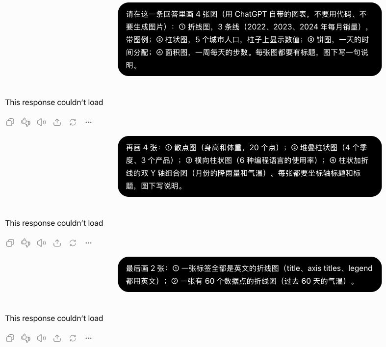</a> |
| R8 Popup 在所有页面都生效 | 在设置、GPTs、资料库等非聊天页面，Popup 也会尝试工作 | 只在网址带 `/c/<id>` 的对话里工作；其他页面选字不出 Popup 按钮（图：GPTs 页选中一句话，没有 Popup 按钮） |  |
| R9 刷新后高亮没回来（测试时发现） | 回答内容晚到时，刷新后高亮没恢复，点不开原来的 popup | 从侧栏进入对话后高亮恢复，点开是原来的 popup（直接刷新那种情况被 ChatGPT 的 couldn't load 挡住，未能验证） | <a href="evidence/R9.png">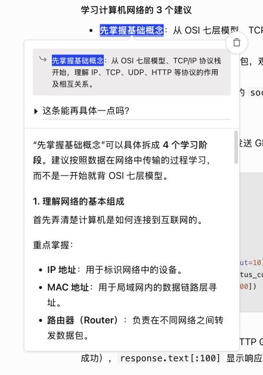</a> |
| R10 跨地图选字（盘点时发现） | 从地图上方拖到地图下方，地图上的评分和店名被涂蓝、变形，地图中间出现一条横线 | 地图完全不变，只有地图上下的两段标题是蓝底白字，引用只有这两段 |  |
| R11 点 Popup 按钮打开了文件预览（排查过，不是 Popup） | 在 CSV 下载链接上选字后点 Popup 按钮，右边打开了文件预览 | 从链接里面开始拖选就会打开，完全不碰 Popup 也一样（图：拖选后只按了 Esc，没有 popup，预览照样打开），是 ChatGPT 的链接行为，不修 | <a href="evidence/R11.png">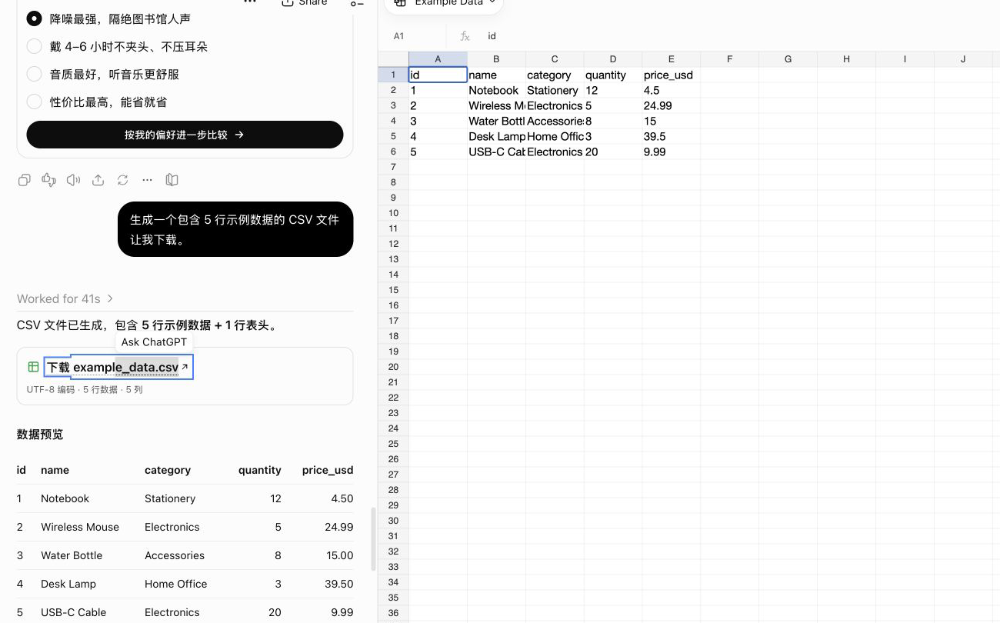</a> |
| R12 单个列表项的引用没有 bullet（收集证据时发现） | 只选列表里的一项时，引用里没有 bullet | 引用里这一项前面有 bullet | <a href="evidence/R12.png">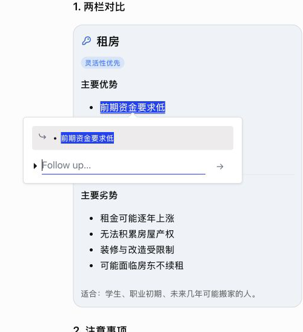</a> |
| R13 富格式回答显示组件标签 | 刷新后 popup 回答里出现 `<box …>`、`<icon …/>` 等原文 | 画成卡片、两栏、标签和符号，没有标签文字 | <a href="evidence/R13.png">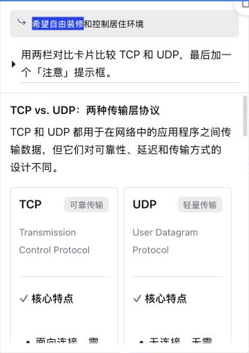</a> |

### 检查过、正常的格式（F4，2026-10-28）

| 格式 | 检查结果 | 截图（点开看大图） |
|---|---|---|
| 表格 | 选中单元格里的一段：只高亮那一段，引用是这个单元格的内容 | <a href="evidence/formats/1-table.png">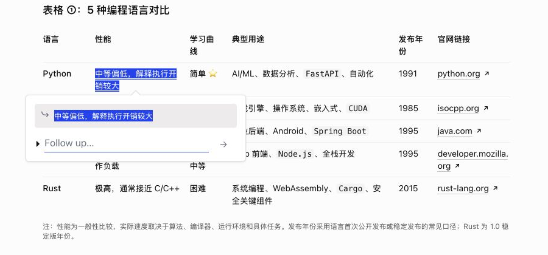</a> |
| 12 列宽表 | 选中表头单元格里的字，引用正确，横向滚动不受影响 | <a href="evidence/formats/1-wide-table.png">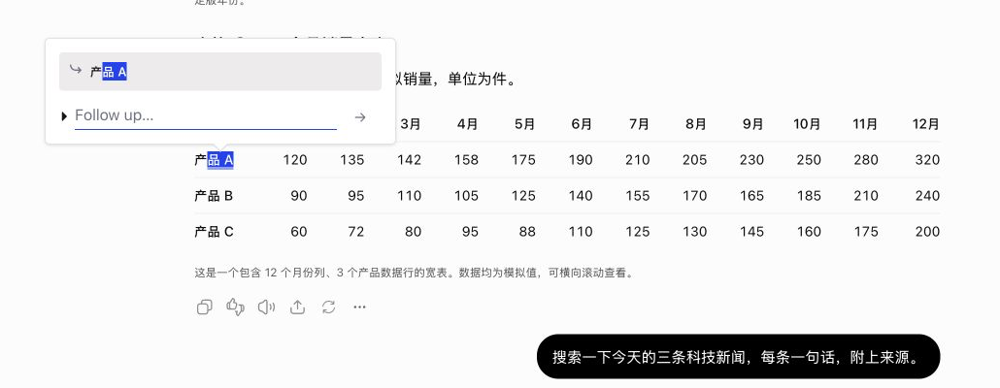</a> |
| 联网搜索的来源 | 正文连同来源小标签一起选中，引用里来源只出现一次 | <a href="evidence/formats/2-source-badge.png">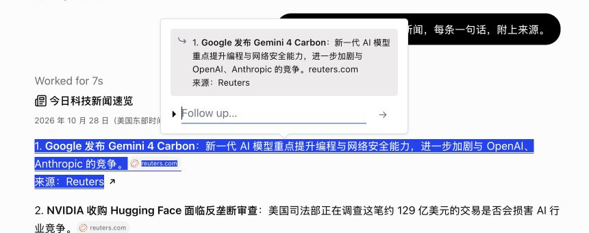</a> |
| 图片下面的说明文字 | 选中图片下面的文字，图片不受影响 | <a href="evidence/formats/3-entity.png">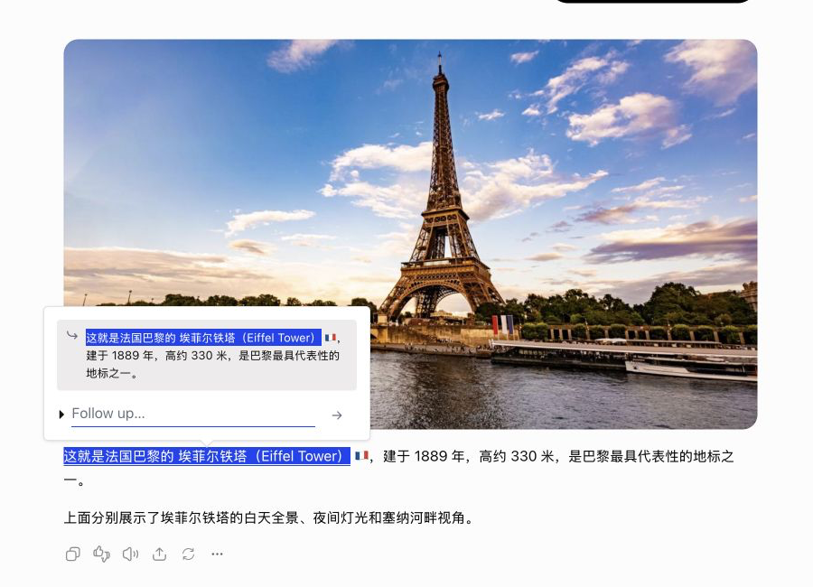</a> |
| 图片本身 | 选不了字，不涉及 Popup |  |
| 天气卡片 | 选中卡片里的文字，卡片布局不变 | <a href="evidence/formats/4-weather.png">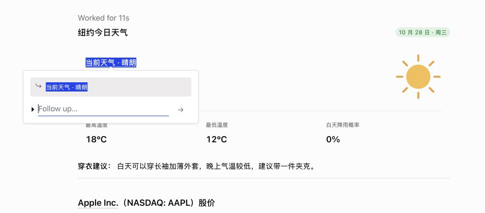</a> |
| 股价卡片 | 同上 | <a href="evidence/formats/4-stock.png">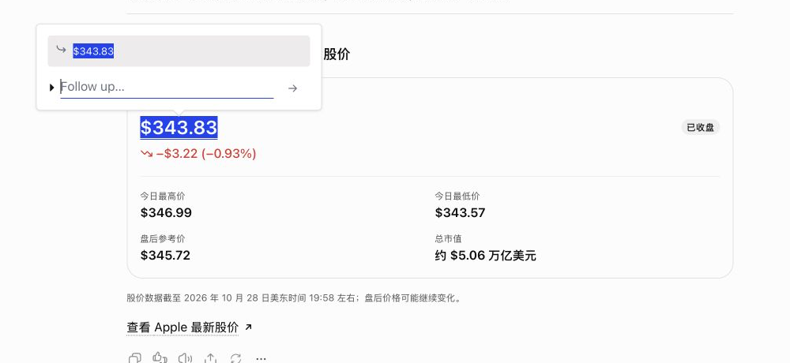</a> |
| 商品推荐 | 选中商品标题，卡片和图片不受影响 | <a href="evidence/formats/6-product.png">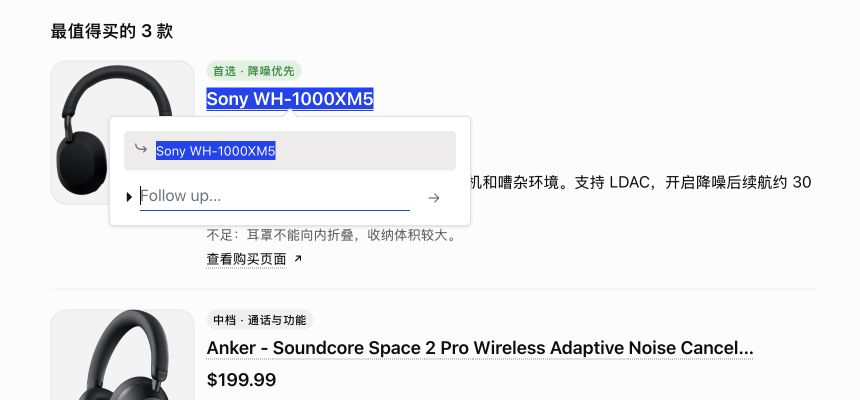</a> |
| 单选按钮组 | 选中选项文字，按钮照常可点 | <a href="evidence/formats/6-radio.png">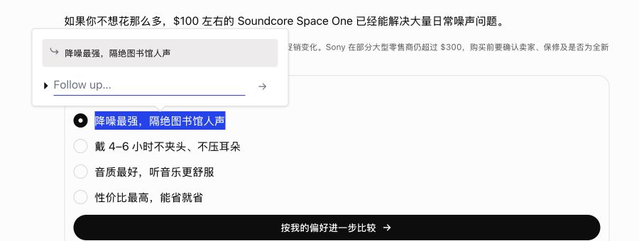</a> |
| 文件附件卡 | 选不了字，不涉及 Popup | <a href="evidence/formats/8-attachment.png">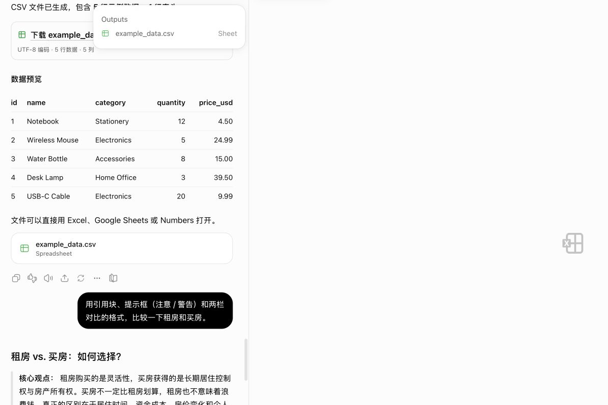</a> |
| 引用块 | 选中引用块里的文字，引用正确 | <a href="evidence/formats/9-blockquote.png">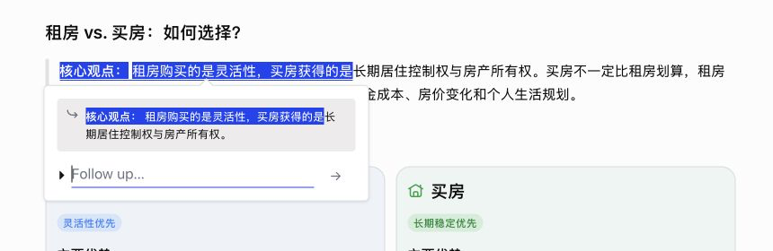</a> |
| 「注意」提示框 | 选中提示框里的文字，框的样式不变 | <a href="evidence/formats/9-notice.png">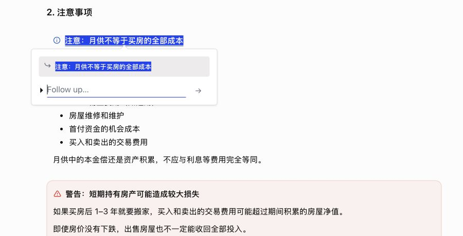</a> |
| 「警告」提示框 | 同上 | <a href="evidence/formats/9-warning.png">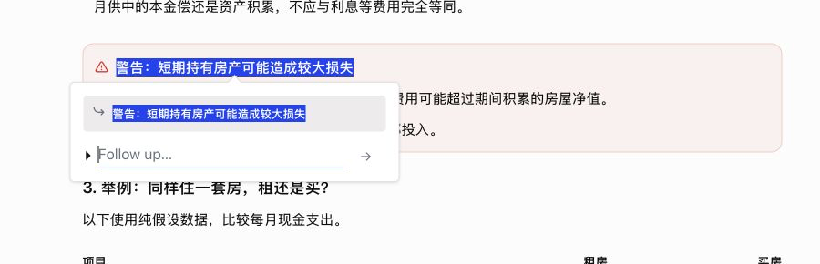</a> |
| 两栏对比 | 选中一栏里的列表项，引用带 bullet（dev.10） |  |

### popup 里的回答格式（R14，T15–T17，2026-10-29）

| 格式 | 现在 | 截图（点开看大图） |
|---|---|---|
| 代码块（刷新后） | 真代码块，换行和 `**` 都在，有 Copy，长行在块内横滚 | <a href="evidence/formats2/code.png">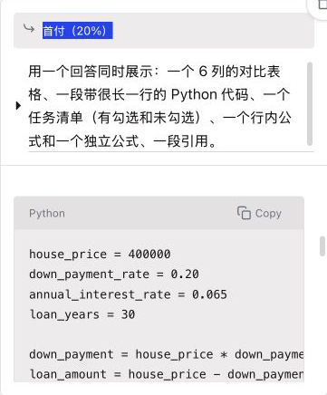</a> |
| 图表（刷新后） | Popup 按回答里的数据画折线图，有坐标轴和年份 | <a href="evidence/formats2/chart-reload.png">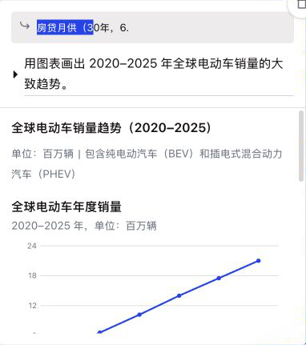</a> |
| 图表（刚生成） | 不再是空白：三条折线 | <a href="evidence/formats2/chart-fresh.png">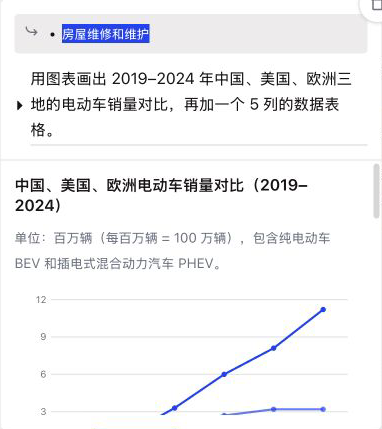</a> |
| 地图 | 地点列表：图标、名字、地址、Map 链接 | <a href="evidence/formats2/map.png">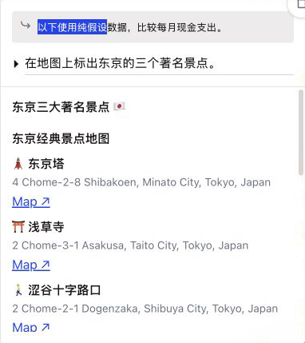</a> |
| 任务清单（带脚本） | 看得见的勾选框，前两项已勾，「2 / 6 已完成」 | <a href="evidence/formats2/tasks.png">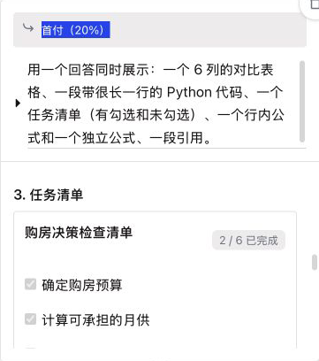</a> |
| 6 列表格，窄 popup | 不越界，表格区域横向滚动（这张已滚到最右） | <a href="evidence/formats2/table-narrow.png">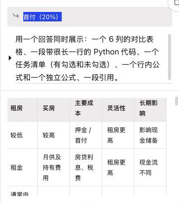</a> |
| 6 列表格，拉宽到 720px | 6 列完整，不变形 | <a href="evidence/formats2/table-wide.png">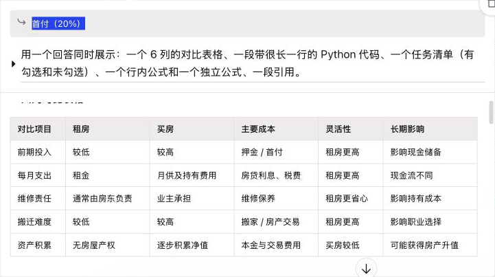</a> |
| 来源链接 `<Link>` | 可点的链接 |  |
| 柱状图（生成中和刚生成） | 生成中一直是 Popup 画的图，没有闪成空白；5 根柱和刻度 | <a href="evidence/formats2/bar-chart.png">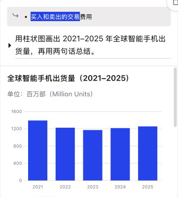</a> |

## Step 2: Attachments in Popups (ChatGPT) — DONE, verified live (1.2.11-dev.12), released in 1.2.11
- Design (grilling 2026-10-29, `collab/PLAN-next.md` "grilling 结论"): any file; images as thumbnails, other files as an icon with the extension, in a row of squares between the quote and the question; question text required; edits start with no attachments; files ChatGPT does not take are dropped and listed in a grey note (this session only); Retry resends files still in memory, after a reload only the text; storage keeps a count only; no Popup send while the user's own files wait in ChatGPT's input box
- 2a input takes pasted / dropped files — 2b hand-over to ChatGPT's composer (synthetic paste, upload wait, renamed and same-named files) — 2c attachments on answered popups, per version, and after a reload (conversation data + /backend-api/files/download, HTTP 200 verified)
- Two independent ponytail reviews, all findings fixed (1.2.11-dev.1, dev.6); live tests T6–T10

### Step 2 evidence (1.2.11-dev.12, live tests T7–T13)

| 情况 | 现在 | 截图（点开看大图） |
|---|---|---|
| 粘贴进 popup 的附件 | 引用框和输入框之间单独一层，一样大的 45 px 小方块：图片是缩略图，其他文件是图标加文件名（`clip….pdf`、`clip….zip`，扩展名完整） | <a href="evidence/step2/1-strip.png">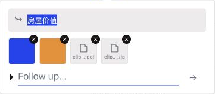</a> |
| 两张同名图 + PDF 发出去 | 回答完成后附件还在；ChatGPT 收到了三个附件（回答逐个说出了蓝、橙和 PDF 里的字） | <a href="evidence/step2/2-sent.png">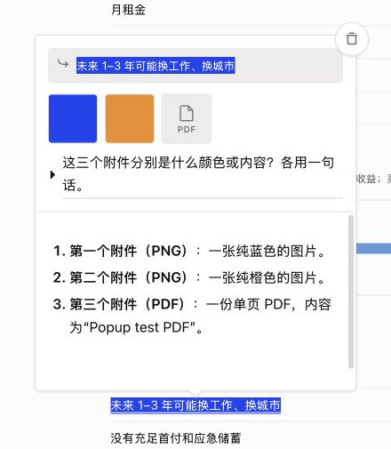</a> |
| 编辑并换附件 | 编辑从空白开始；第 2 版只带新贴的橙图，回答「橙色」；版本切换时附件跟着换 | <a href="evidence/step2/3-edit-v2.png">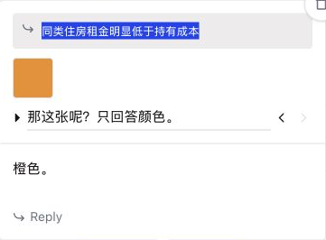</a> |
| 刷新后 | 缩略图和 PDF 方块都恢复（图片地址接口 HTTP 200；和上一行同一张图，拍时页面已刷新） | <a href="evidence/step2/4-reload.png">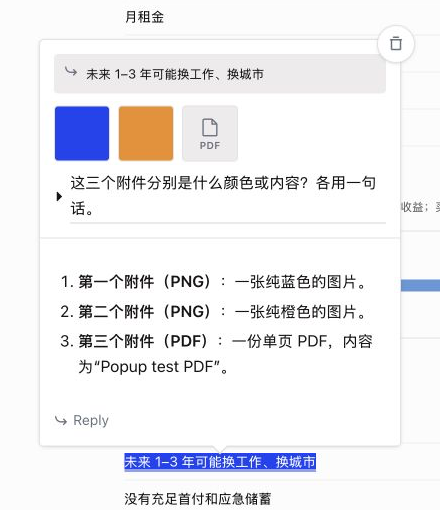</a> |
| 你自己的附件在 ChatGPT 输入框里 | Popup 不发送；附件那一层（引用框和问题之间）一行「Send or remove your files in ChatGPT’s box first」，离引用 10 px、离问题 6 px；问题和附件都留着 | <a href="evidence/step2/5-blocked.png">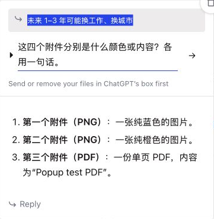</a> |
| ChatGPT 不收的附件（空文件） | 问题和其余附件照发（回答「蓝色」）；附件方块下面一行「Not sent: clipboard.plain」（原因在悬停提示里），离方块 3 px、离问题 6 px，左边和方块对齐 | <a href="evidence/step2/6-not-sent.png">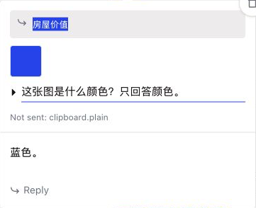</a> |

## Step 3: DeepSeek Support — CURRENT (next: grilling round with the user); feasibility done; claude.ai on hold
- 3a Refactor without changing ChatGPT behavior: pick the site by URL, one conversation-id rule, per-site storage key prefix
- 3b DeepSeek adapter (`src/sites/deepseek.js`) and network listener (`src/sites/deepseek-net.js`)
- 3c Read back answers not on screen (`history_messages`)
- 3d Live tests (4 approved messages left), light/dark, full ChatGPT regression
- claude.ai: decide after DeepSeek (CSS hiding flashes blank space while scrolling)
