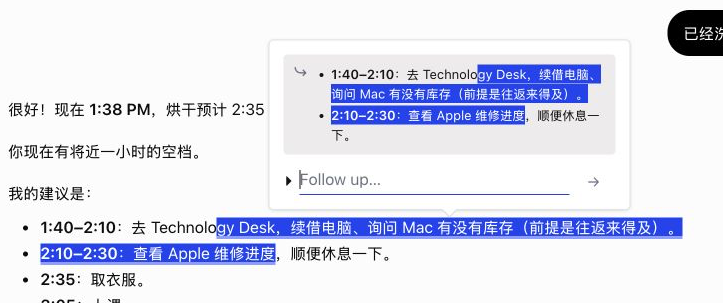
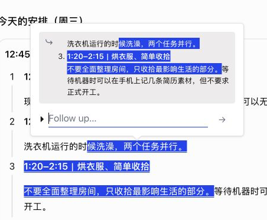
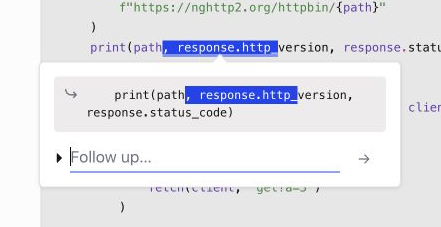
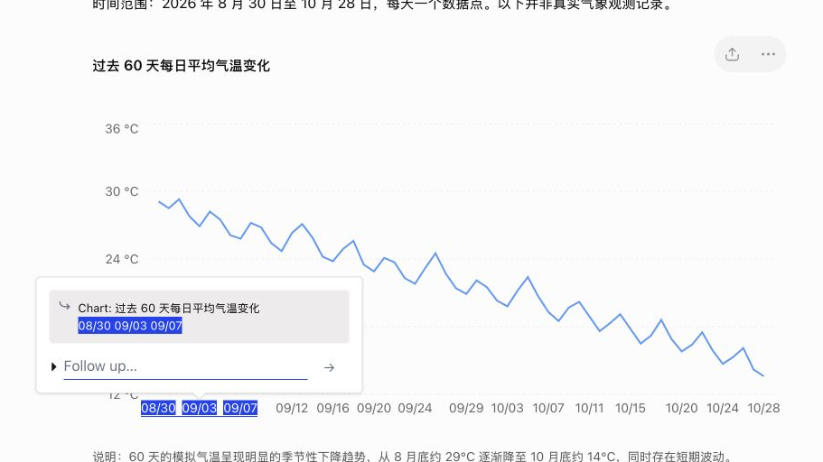
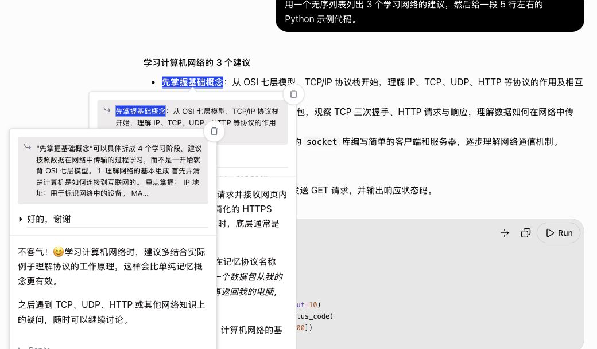
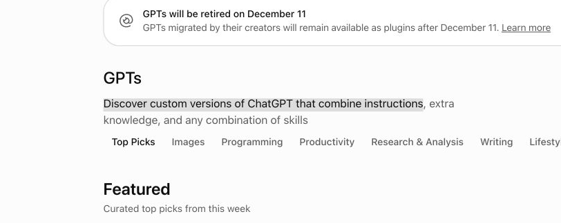
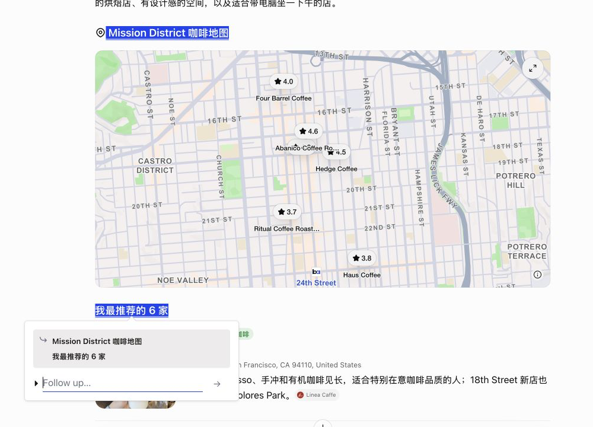

# TODO — 2026 H2: Maintenance & Updates

The development-phase steps (2026 H1, Steps 1–9) are in [TODO.md](TODO.md) and closed.
Work through these steps **in order**. Do not skip ahead or add features from later steps.
Detailed plans: `collab/PLAN-next.md` (Chinese).

## Step 1: Special Response Formats (ChatGPT) — CURRENT
- Plan and test matrix: `collab/PLAN-next.md`, section "特殊回答格式审查"
- Known bugs:
  - R1 a quote spanning list items repeats a bullet — fixed 1.2.10-dev.1, verified T1
  - R2 the same for ChatGPT's new step cards (numbered cards with a tag chip) — fixed dev.1, verified T1
  - R3 code blocks get no page highlight; their quote includes toolbar text ("PythonRun") and loses line breaks — fixed dev.2 (quote) + dev.3 (highlight), verified T1
  - R4 highlighting chart axis labels breaks the SVG chart and throws the popup to the bottom of the page — fixed dev.3, white label text dev.5, verified T1/T3 (legend and tooltip text cannot be selected at all)
  - R5 the Reply quote (and the message sent) ends with the word "Reply" — fixed dev.1, verified T1
  - R6 clicking Reply while its reply popup is open stacks another copy of it — fixed dev.1, verified T1
  - Review (ponytail, 2026-10-28) of dev.1-dev.5 → fixed in dev.6: removing a chart/code highlight no longer runs normalize() inside the CodeMirror editor; ChatGPT selectors only in the site adapter. Live test T4 (dev.6): R1-R6 regression passed; code block intact after Esc and after deleting a sent highlight; copy button works after Popup was used (one copy right after a delete did not update the clipboard once and could not be reproduced; the code block's DOM was byte-identical, so it is put down to the test tool)
  - R7 (checked, closed) "This response couldn't load" after a reload: also with Popup switched off, so it is ChatGPT's own (DEBUG #56); not fixed
  - R10 a selection across a map widget highlighted (and garbled) the map's own marker labels and ratings, and drew a line across the map — fixed 1.2.10-dev.8/dev.9 (highlights skip text the browser does not select or show: user-select: none, visibility: hidden, opacity 0 on its own element), verified T5 (map clean, highlights still restore)
  - R12 (found while collecting evidence) a selection inside one item of a current list (li > div > div > p) lost its bullet in the quote: the single-item path still used the old first-child rule — fixed 1.2.10-dev.10
  - R11 (checked, closed) opening the file preview after selecting the CSV download link: ChatGPT treats a drag that starts inside a link as a click; not Popup
  - R8 — fixed 1.2.10-dev.7, verified F3 (off on new-chat, temporary chat, GPTs, library, Codex, project home, settings; on in chats; entering a chat from the home page restores highlights; leaving a chat removes popups and the nav widget; project chats untested: no project chat exists yet). Decided with the user: Popup works only on pages whose path has /c/<id> — normal, GPT and project chats; off on every other page and in temporary chats; "off" = no trigger button, nav widget, storage reads or page observers, while the network filter keeps running so hidden Q&As stay hidden the moment a chat opens) Popup is active on every chatgpt.com page (settings, GPTs, library, …), not only in chats. Note: ChatGPT is a single-page app, so the content scripts must still load on all pages (no reload when moving between pages); Popup has to switch itself on and off by route.
  - R9 (found in live test T1, fix in 1.2.10-dev.4) after a reload, a highlight in an answer that fills in late is not restored — verified when entering the chat from the sidebar (T2); a direct reload could not be tested: that answer always showed ChatGPT's own "This response couldn't load" (3 tries, T3)
- 1a Inventory ChatGPT's high-risk answer components (lists, step cards, tables, code, math, charts/widgets, citations, collapsibles) — in progress (F4, 2026-10-28): tables, web-search sources, image/map/weather/stock/shopping cards, collapsibles/files/canvas/callouts, plus a census of every widget type in each answer to catch new formats. User approved 15 more test messages. Each problem found gets an R-number and the same full flow as R1–R6; formats that already work get one line in collab/PLAN-next.md
- 1b Offline fixtures in `tools/dom-test.html` for each component; checks C1–C9; they fail on R1–R4 before any fix
- 1c Fixes (design confirmed with the user first), then live verification and full regression

### Step 1 evidence (live test by the operator, 2026-10-28)

| Bug | 当时的现象 | 现在 | 截图（点开看大图） |
|---|---|---|---|
| R1 列表引用重复 | 选区跨两个 bullet，引用里同一个 bullet 出现两次 | 每条只出现一次，时间粗体保留 |  |
| R2 步骤卡片重复 | 选区跨两步，引用里第 3 步重复 | 每项一次，新的一项前面有序号「3.」 |  |
| R3 代码 | 页面代码没有高亮；引用是「PythonRunimport asyncio…」整块连成一段 | 页面上蓝底白字高亮，代码块没变；引用只有碰到的那一行，等宽、缩进保留 |  |
| R4 图表 | 选中坐标轴数字后图表坏掉（数字被截断或消失），popup 飞到页面底部 | 图表完好，选中的刻度蓝底白字，popup 在旁边，引用是「Chart: 标题」加选中的文字 |  |
| R5 Reply 引用带「Reply」 | reply popup 的引用末尾是「…还是只是来打个招呼？ Reply」 | 引用以回答本身结束，没有「Reply」 |  |
| R6 Reply 重复叠 popup | 再点 Reply 会叠出 4 层一样的 reply popup | 点两次 Reply，仍然只有原 popup 和一个 reply popup（2 层） |  |
| R8 Popup 在所有页面都生效 | 在设置、GPTs、资料库等非聊天页面，Popup 也会尝试工作 | 只在网址带 `/c/<id>` 的对话里工作；其他页面选字不出 Popup 按钮（图：GPTs 页选中一句话，没有 Popup 按钮） |  |
| R10 跨地图选字（盘点时发现） | 从地图上方拖到地图下方，地图上的评分和店名被涂蓝、变形，地图中间出现一条横线 | 地图完全不变，只有地图上下的两段标题是蓝底白字，引用只有这两段 |  |

## Step 2: Images in Popups (ChatGPT) — plan approved, step 0 done
- Paste or drag images into a popup's input; ChatGPT uploads them through its own flow (synthetic `paste` on the composer works; file input and `drop` don't)
- 2a Popup inputs accept images, thumbnail strip
- 2b Send: attach to the composer, wait for the upload, fix send timers, `questionFromBody` in `src/net-tap.js`
- 2c Show images in popups; storage keeps only an `images` count; read back after reload
- Evaluation probes (`src/dev-imgtest.js`) never go into the store zip

## Step 3: DeepSeek Support — feasibility done; claude.ai on hold
- 3a Refactor without changing ChatGPT behavior: pick the site by URL, one conversation-id rule, per-site storage key prefix
- 3b DeepSeek adapter (`src/sites/deepseek.js`) and network listener (`src/sites/deepseek-net.js`)
- 3c Read back answers not on screen (`history_messages`)
- 3d Live tests (4 approved messages left), light/dark, full ChatGPT regression
- claude.ai: decide after DeepSeek (CSS hiding flashes blank space while scrolling)
